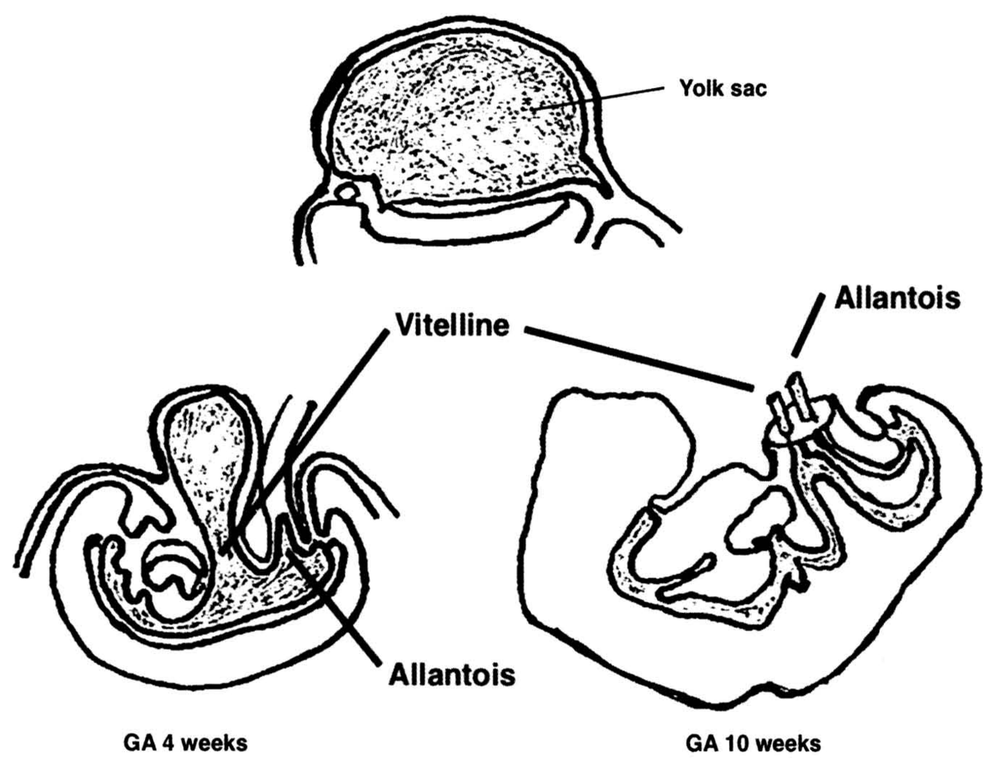
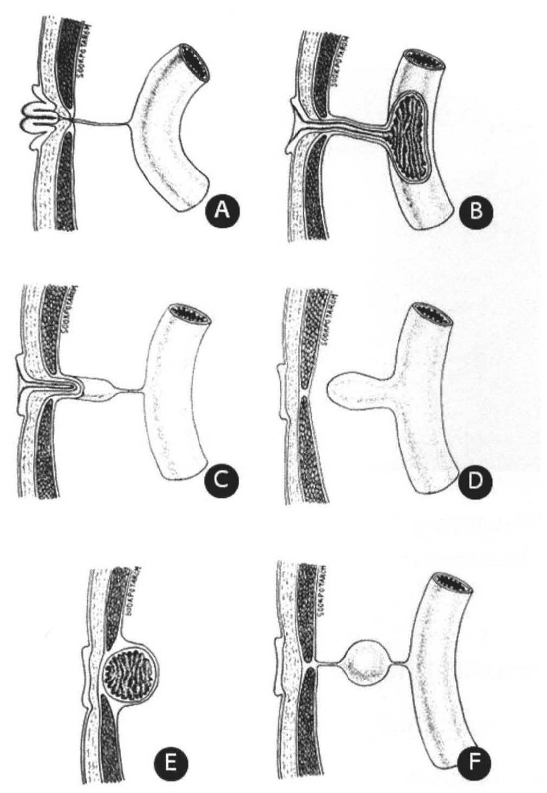
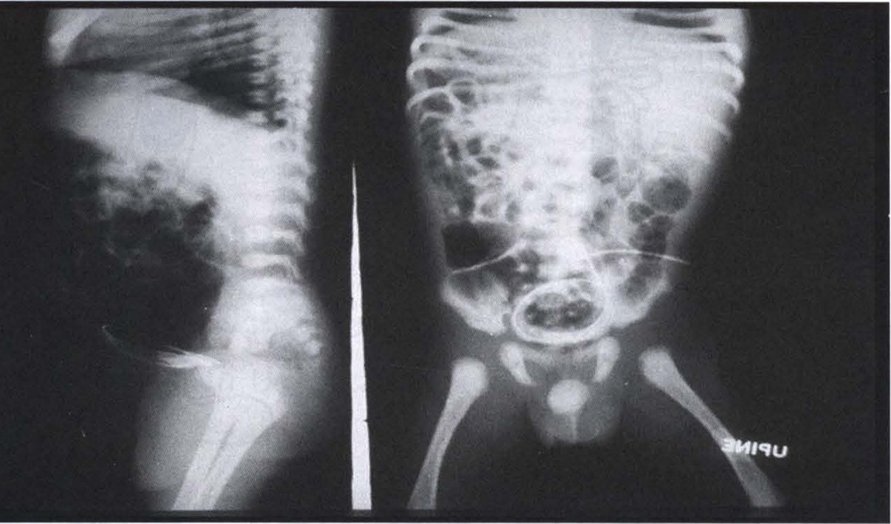
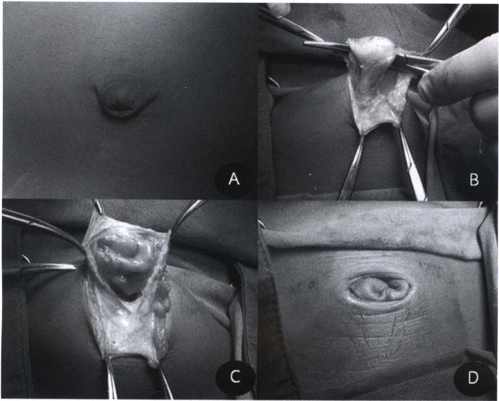
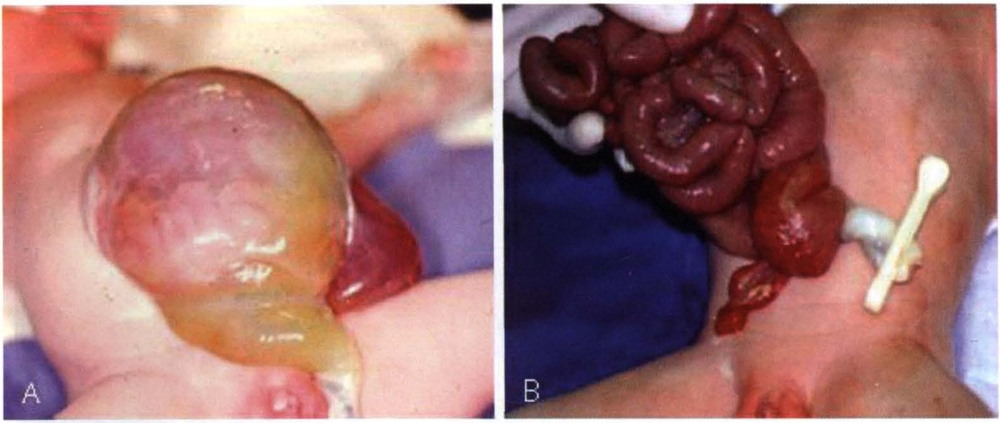
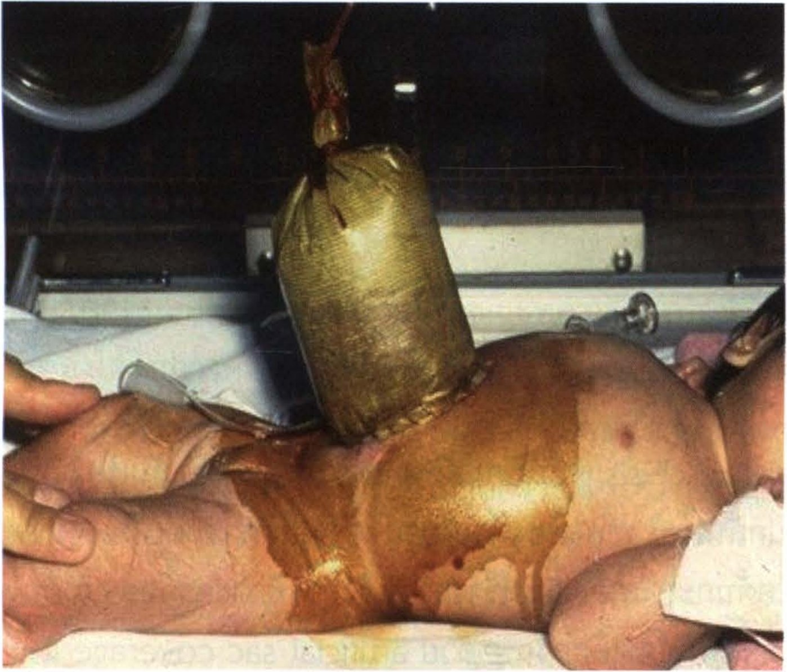
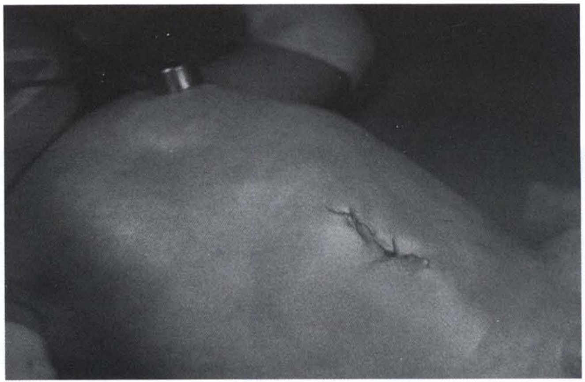

# ปัญหาบริเวณสะดือและความผิดปกติแต่กำเนิดของผนังหน้าท้อง (Umbilical problem and Congenital abdominal wall defects)

## Contents of this file
- ปัญหาบริเวณสะดือในเด็ก (p.998)
  - สะดืออักเสบ (Umbilical infections, Omphalitis) (p.999)
  - สะดือแฉะ (Weeping umbilicus) (p.1000)
  - สะดือจุ่น (Umbilical hernia) (p.1002)
- ความผิดปกติแต่กำเนิดของผนังหน้าท้อง (Congenital abdominal wall defects) (p.1003)
  - คัพภวิทยาและพยาธิกำเนิด (p.1004)
  - การวินิจฉัยก่อนคลอดและการคลอด (p.1005)
    - ลักษณะทางคลินิก (p.1005)
    - การดูแลเบื้องต้น (p.1006)
    - การรักษาจำเพาะ (p.1006)
      - Gastroschisis (p.1008)
    - การดูแลหลังผ่าตัด (p.1009)
- สรุป (p.1009)
- เอกสารอ้างอิง (p.1010)

<!-- p.997 (printed none) -->
**ปัญหาบริเวณสะดือและความผิดปกติแต่กำเนิดของผนังหน้าท้อง**

**Umbilical problem and Congenital abdominal wall defects**

ประภาพรรณ รัชตะปีติ

<!-- p.998 (printed 984) -->
**ปัญหาบริเวณสะดือและความผิดปกติแต่กำเนิดของผนังหน้าท้อง**

**Umbilical problem and Congenital abdominal wall defects**

ประภาพรรณ รัชตะปีติ

ปัญหาบริเวณสะดือเป็นภาวะที่พบได้บ่อยในการตรวจผู้ป่วยนอก ผู้ป่วยส่วนมากสามารถรักษาได้โดยไม่ต้องผ่าตัด ในขณะที่ความผิดปกติแต่กำเนิดของผนังหน้าท้องต้องได้รับการวางแผนการรักษาที่เหมาะสมตั้งแต่อยู่ในครรภ์มารดา

## ปัญหาบริเวณสะดือในเด็ก1

สะดืออยู่บริเวณผนังหน้าท้อง บริเวณที่เคยเป็นก้านลำตัว (Body stalk) ซึ่งเป็นตำแหน่งเชื่อมต่อระหว่าง Yolk sac กับตัวอ่อน เมื่อตัวอ่อนเจริญเติบโตขึ้นทางเชื่อมนี้จะแคบลง มีชื่อเรียกว่าท่อ Vitelline หรือท่อ omphalomesenteric นอกจากนี้ยังมีส่วน allantois buds ซึ่งเรียกว่า urachus และหลอดเลือด umbilical รวมอยู่ในก้านลำตัว เมื่อผนังหน้าท้องเจริญขึ้น ท่อ vitelline และ urachus ค่อยๆ แคบลงและฝ่อสลายไปเมื่อครบกำหนดคลอด (รูปที่ 1)

*[handwritten reader note omitted]*

<!-- p.999 (printed 985) -->

> **Caption (verbatim):** **รูปที่ 1** แสดงความสัมพันธ์ของ vitelline duct, allantois (urachus) และ body stalk
> **Text in image (verbatim):** Yolk sac · Vitelline · Allantois · Allantois · GA 4 weeks · GA 10 weeks
> **Description:** Black-and-white line drawing of embryonic development in three parts. Top centre: a large dome-shaped stippled sac labelled "Yolk sac", sitting above the curved outline of the early embryo. Bottom left (labelled "GA 4 weeks"): a sagittal-section drawing of a curled embryo with a stippled flask-shaped yolk sac projecting upward from its ventral side; a line labelled "Vitelline" points to the narrow duct connecting the yolk sac to the embryo, and a line labelled "Allantois" points to a smaller diverticulum lower in the body stalk region. Bottom right (labelled "GA 10 weeks"): an outline drawing of a larger, more developed fetus in profile; at the umbilical region a small stump with two short tubular structures projects outward, with one label line "Vitelline" (shared with the 4-week drawing) and a separate label line "Allantois" pointing to these structures in the umbilical cord stump.
> **Identifiers in image:** none

ภายหลังคลอดและสายสะดือถูกผูกแล้ว ในภาวะปกติสายสะดือจะแห้งหลุดไปเองภายในประมาณ 7 วัน และมีผิวหนังขึ้นมาคลุม แต่ในบางรายอาจเกิดภาวะสะดืออักเสบ สะดือแฉะ หรือสะดือจุ่น ซึ่งเป็นปัญหาที่ผู้ปกครองมักพามาพบแพทย์

### สะดืออักเสบ (Umbilical infections, Omphalitis)

มักพบในทารกที่ได้รับการตัดสายสะดือด้วยอุปกรณ์ที่ไม่ปราศจากเชื้อ หรือได้รับการดูแลความสะอาดไม่ดี เชื้อที่พบส่วนมาก ได้แก่ เชื้อแบคทีเรียแกรมบวก เช่น *Staphylococcus aureus* หรือ *Streptococcus pyogenes* เชื้อบาดทะยักพบได้ไม่บ่อยแต่ควรคำนึงถึงในกรณีใช้อุปกรณ์พื้นบ้าน เช่น ไม้ไผ่ ตัดสายสะดือ ทารกที่มีภาวะสะดืออักเสบอาจมาด้วยลักษณะผิวหนังบริเวณสะดืออักเสบ บวม แดง (cellulitis) หรือมีหนอง (purulent discharge) บริเวณสะดือ

*[handwritten reader note omitted]*

<!-- p.1000 (printed 986) -->
การรักษาทำได้โดยการดูแลบริเวณสะดือให้สะอาด และให้ยาปฏิชีวนะ ในบางรายหากรักษาช้าอาจติดเชื้อรุนแรง นอกจากนี้อาจมีการติดเชื้อผ่านทางเส้นเลือด umbilical ซึ่งอาจส่งผลให้เกิด portal venous thrombosis และเกิดภาวะ portal hypertension ภายหลังได้

### สะดือแฉะ (Weeping umbilicus)

ผู้ปกครองมักพามาด้วยปัญหาหลังสายสะดือหลุดแล้วยังมีภาวะสะดือแฉะ มีน้ำซึม ซึ่งอาจเกิดจากสาเหตุต่างๆ ได้แก่ Umbilical granuloma การคงอยู่ของท่อ vitelline หรือ urachus

*[handwritten reader note omitted]*

Umbilical granuloma คือภาวะที่มี granulation tissue ขึ้นบริเวณฐานสะดือหลังจากสายสะดือหลุดไปแล้ว มีลักษณะเป็นเนื้อเยื่อสีแดง ขนาดมักไม่ใหญ่ รักษาได้ด้วยการใช้เกล็ด silver nitrate จี้เพื่อทำลาย granulation tissue โดยต้องระวังไม่ให้โดนบริเวณผิวหนังปกติ เนื่องจากจะเกิดการระคายเคืองได้ อาจต้องจี้ซ้ำ 2-3 ครั้ง ทุก 1-2 สัปดาห์ หรือหากยังไม่หายอาจต้องจี้ตัดออกด้วยจี้ไฟฟ้า กรณีที่รักษาด้วยการจี้ไม่ได้ผลต้องประเมินซ้ำว่าเป็น true polyp หรือมี sinus tract หรือไม่

การคงอยู่ของท่อ vitelline (Patent vitelline or omphalomesenteric duct) ทำให้มีทางเชื่อมระหว่างสะดือกับลำไส้เล็กส่วนปลาย (ileum) อาจพบว่าน้ำซึ่งไหลออกมามีลักษณะคล้ายอุจจาระ และหากนำไปตรวจจะพบว่ามีคุณสมบัติเป็นด่าง ตรวจร่างกายพบลักษณะคล้ายเนื้อเยื่อลำไส้และมีรูเปิด การตรวจ fistulogram สามารถช่วยยืนยันการวินิจฉัย โดยจะพบสารทึบรังสีผ่านเข้าไปในลำไส้เล็ก แต่อาจไม่จำเป็นในบางรายที่พบว่ามีลำไส้เล็กปลิ้นออกมาบริเวณสะดือ (external intussusception) การรักษาคือการผ่าตัด fistula tract ออก นอกจากนี้การที่ท่อ vitelline สลายตัวไม่หมดอาจทำให้มีความผิดปกติรูปแบบอื่น เช่น sinus polyp หรือ Meckel diverticulum (รูปที่ 2)

<!-- p.1001 (printed 987) -->

> **Caption (verbatim):** **รูปที่ 2** แสดงความผิดปกติของ patent omphalo-mesenteric duct A : umbilical polyp, B : omphalomesenteric fistula, C : umbilical sinus, D : Meckel’s diverticulum, E : umbilical cyst, F : fibrous band with cyst (เอื้อเฟื้อรูปภาพโดย นพ. ไพศาล เวชชพิพัฒน์)
> **Text in image (verbatim):** A · B · C · D · E · F · SOOKPOTARAM (small vertical illustrator signature repeated on each panel)
> **Description:** Six shaded pencil-style anatomical drawings arranged in three rows of two (A, B / C, D / E, F), each a sagittal cross-section of the anterior abdominal wall at the umbilicus (vertical layered strip with a dark-stippled muscle layer, on the left) with a curved segment of small intestine (ileum) on the right. A (umbilical polyp): a small mucosal polypoid knob protrudes from the skin at the umbilicus, with only a thin cord running from the umbilicus to the bowel. B (omphalomesenteric fistula): an open tube runs from the umbilical skin through the abdominal wall directly into the bowel lumen, whose mucosal folds are shown. C (umbilical sinus): a blind tract opens at the umbilicus and ends within/just beyond the wall, connected to the bowel only by a thin cord. D (Meckel’s diverticulum): a finger-like blind outpouching projects from the bowel toward, but not attached to, the umbilicus. E (umbilical cyst): a round cyst lined with folded mucosa lies within the abdominal wall beneath the umbilicus, with no bowel connection. F (fibrous band with cyst): a thin fibrous band runs from the umbilicus to the bowel with a round smooth cyst in the middle of the band. Each panel is marked with a white letter in a black circle.
> **Identifiers in image:** none

*[handwritten reader note omitted]*

การคงอยู่ของ urachus (Patent urachus) ทำให้มีทางติดต่อระหว่างสะดือกับกระเพาะปัสสาวะ (รูปที่ 3) น้ำที่ไหลออกมาบริเวณสะดือมักมีปริมาณมากกว่าภาวะสะดือแฉะจากสาเหตุอื่นและมีคุณสมบัติเป็นกรด เด็กอาจมีประวัติกระเพาะปัสสาวะติดเชื้อเป็นๆ หายๆ ในรายที่เป็น urachal cyst มักเกิดการติดเชื้อ และมาด้วยอาการปวดบริเวณสะดือหรือท้องน้อย สามารถยืนยันการวินิจฉัยได้ด้วยการตรวจด้วยคลื่นเสียงความถี่สูง หรือ fistulogram ในรายที่เห็นรูเปิด การรักษาคือการผ่าตัดเลาะ fistula tract ออก

<!-- p.1002 (printed 988) -->

> **Caption (verbatim):** **รูปที่ 3** Fistulogram ของการคงอยู่ของ urachus จะเห็นสายทำ fistulogram ขดอยู่ในกระเพาะปัสสาวะ
> **Text in image (verbatim):** UPINE (partial marker, mirror-reversed, on the right panel)
> **Description:** Two side-by-side plain radiographs of an infant's abdomen and pelvis from a fistulogram study, separated by a thin white vertical strip. Left panel: lateral view of the abdomen with the spine on the right side of the panel; a thin radiopaque catheter enters from the anterior abdominal wall in the lower abdomen. Right panel: frontal (supine) view of the abdomen and pelvis showing bowel gas pattern, the lower ribs, iliac bones and femoral heads; a thin radiopaque catheter crosses the lower abdomen and forms a ring-shaped coil in the pelvis, in the region of the urinary bladder, which the caption identifies as the fistulogram catheter coiled within the bladder. Identifier label cropped out.
> **Identifiers in image:** none

### สะดือจุ่น (Umbilical hernia)2

สะดือจุ่นหรือไส้เลื่อนบริเวณสะดือเป็นภาวะที่พบได้บ่อยในเด็ก มีความต่างจากไส้เลื่อนบริเวณอื่นคือแม้จะมี fascial defect แต่กำเนิด แต่มีโอกาสหายได้โดยไม่ต้องอาศัยการผ่าตัด ภาวะนี้เกิดจากการที่ umbilical ring ปิดไม่สมบูรณ์ ทำให้ลำไส้สามารถเคลื่อนผ่านช่องโหว่ดังกล่าวโดยมี peritoneum เป็นถุงคลุมอยู่ใต้ผิวหนังบริเวณสะดือ ขนาดของก้อนจะโป่งขึ้นเมื่อเด็กร้องหรือเบ่ง การตรวจร่างกายโดยการคลำผ่านบริเวณก้อนเพื่อประเมินขนาดของรูโหว่สามารถยืนยันการวินิจฉัยได้โดยไม่ต้องตรวจพิเศษเพิ่มเติม

*[handwritten reader note omitted]*

เมื่อเด็กโตขึ้นช่องเปิดบริเวณ umbilical ring จะถูกเสริมความแข็งแรงจากเนื้อเยื่อรอบข้างและมีโอกาสปิดได้เองถึงร้อยละ 90 ภายในอายุ 1 ปี และการเกิดภาวะแทรกซ้อน เช่น ไส้เลื่อนค้างพบได้น้อยมาก การรักษาเบื้องต้นจึงแนะนำให้สังเกตอาการ โดยแนะนำผู้ปกครองไม่ให้รัดหรือใช้เหรียญปิดดันบริเวณสะดือ เพราะไม่ช่วยให้ปิดเร็วขึ้นและยังอาจทำให้เกิดการติดเชื้อได้ พิจารณาผ่าตัดเมื่อภาวะสะดือจุ่นยังไม่หายไปเองขณะอายุ 4-5 ปี หรือมีขนาดช่องโหว่กว้างกว่า 1.5 ซม. เนื่องจากกลุ่มดังกล่าวมีโอกาสหายเองได้น้อย การผ่าตัดรักษาโดยการทำ umbilicoplasty (รูปที่ 4)

<!-- p.1003 (printed 989) -->

> **Caption (verbatim):** **รูปที่ 4** แสดงการผ่าตัด umbilicoplasty (เอื้อเฟื้อรูปภาพโดย นพ. ไพศาล เวชชพิพัฒน์)
> **Text in image (verbatim):** A · B · C · D
> **Description:** Four black-and-white intraoperative photographs in a 2 × 2 grid showing the steps of umbilicoplasty for umbilical hernia in a child. A: close-up of the abdominal skin with a curved (semicircular) infra-umbilical skin incision outlined/made around the lower edge of the umbilicus. B: the hernia sac has been dissected free and is held up between the jaws of a clamp, with haemostat clamps retracting the wound edges and a gloved finger at the right; surgical drapes surround the field. C: the opened, thin-walled hernia sac is spread out with several clamps, showing the fascial defect beneath. D: completed repair with the umbilicus reconstructed; the skin is closed and the umbilical dimple appears as an oval depression, with drapes framing the field and faint skin markings visible.
> **Identifiers in image:** none

## ความผิดปกติแต่กำเนิดของผนังหน้าท้อง (Congenital abdominal wall defects)3-5

ความผิดปกติของผนังหน้าท้องมีการรายงานมานานแล้ว โดยความผิดปกติที่จะกล่าวถึงในบทนี้ 2 ชนิด ได้แก่ omphalocele และ gastroschisis ได้มีผู้ให้คำนิยามไว้ตั้งแต่ศตวรรษที่ 16 โดยภาวะ omphalocele มีผนังหน้าท้องไม่สมบูรณ์ทำให้อวัยวะภายในช่องท้องเลื่อนผ่านออกมาโดยมี peritoneum และ amnion คลุมอวัยวะนั้นอยู่ ส่วน gastroschisis จะไม่มีถุงคลุมและมักมีเพียงลำไส้เล็กผ่านออกมา (รูปที่ 5)

*[handwritten reader note omitted]*

<!-- p.1004 (printed 990) -->

> **Caption (verbatim):** **รูปที่ 5** ภาพทารกที่มี omphalocele (A) และ gastroschisis (B)
> **Text in image (verbatim):** A · B
> **Description:** Two colour clinical photographs of newborns' abdomens, side by side. A (omphalocele): a large, rounded, translucent membranous sac protrudes from the centre of the anterior abdominal wall; pinkish-red viscera are seen through the thin sac wall, and the umbilical cord arises from the lower part of the sac and runs downward. A small segment of reddish tissue is visible at the right edge of the sac. B (gastroschisis): a mass of thickened, dark red, matted loops of intestine lies outside the abdomen with no covering sac, emerging from the abdominal wall beside the umbilical cord; the cord stump is clamped with a white plastic umbilical clamp to the right of the bowel. A gloved hand holds the bowel at the top; blue drapes are in the background. No faces are shown.
> **Identifiers in image:** none

### คัพภวิทยาและพยาธิกำเนิด3-7

ปัจจุบันยังไม่มีทฤษฎีใดอธิบายกลไกการเกิด Omphalocele และ Gastroschisis ได้อย่างชัดเจน โดยเชื่อว่าปัจจัยหลักอยู่ที่ความผิดปกติของการเจริญของผนังหน้าท้อง โดยอาจมีปัจจัยเสี่ยงภายนอกจากมารดาร่วมด้วย

*[handwritten reader note omitted]*

**Omphalocele** เชื่อว่ากลไกการเกิดเกี่ยวข้องกับการพัฒนาของ ventral body wall ซึ่งเจริญมาจากเนื้อเยื่อ 4 folds ได้แก่ ด้านบน (cephalic fold) ด้านล่าง (caudal fold) และด้านข้าง (lateral folds) ซึ่งทำให้พบพยาธิสภาพในตำแหน่งที่ต่างกันไปได้ เช่น epigastric omphalocele ซึ่งอาจพบร่วมกับกลุ่มอาการ pentalogy of Cantrell หรือหาก caudal fold ผิดปกติ จะเกิด hypogastric omphalocele ร่วมกับ cloacal exstrophy ได้ อย่างไรก็ดีมีบางความเห็นเชื่อว่า omphalocele เกิดจากการที่ midgut ไม่เคลื่อนกลับมาในช่องท้องซึ่งเข้าได้กับลักษณะที่มีสายสะดือยึดอยู่บนถุง omphalocele

**Gastroschisis** ผนังหน้าท้องจะเริ่มสร้างขณะเป็นตัวอ่อนได้ 4 สัปดาห์ ระหว่างนั้น midgut ซึ่งยื่นเข้าไปใน umbilical cord จะมีการพัฒนาแล้วม้วนกลับเข้ามาในช่องท้องประมาณสัปดาห์ที่ 10 เชื่อว่าหากเกิดการผิดพลาดในช่วงเวลาดังกล่าวจะนำมาสู่ความผิดปกติของผนังหน้าท้อง ทฤษฎีหนึ่งเชื่อว่าการที่ lateral fold ไม่พัฒนา ทำให้เกิดช่องโหว่ซึ่งมักพบทางด้านขวาของสายสะดือ บางความเห็นเชื่อว่าการที่ umbilical vein ด้านขวาสลายไปทำให้ผนังด้านขวาของ body stalk อ่อนแอลง หรือในอดีตบางท่านเกิดจากการฉีกขาดของถุง omphalocele

<!-- p.1005 (printed 991) -->
### การวินิจฉัยก่อนคลอดและการคลอด8, 9

การตรวจด้วยคลื่นเสียงความถี่สูง (ultrasonography) สามารถตรวจวินิจฉัยความผิดปกติแต่กำเนิดของผนังหน้าท้องได้ตั้งแต่อยู่ในครรภ์มารดาประมาณสัปดาห์ที่ 10-12 นอกจากนี้ยังพบว่ามารดาจะมีระดับ alfa-fetoprotein สูงโดยเฉพาะในภาวะ gastroschisis เมื่อตรวจพบความผิดปกติของผนังหน้าท้อง สิ่งที่ต้องประเมิน ได้แก่ ชนิดของความผิดปกติ อวัยวะที่ยื่นออกมานอกช่องท้อง ความพิการร่วม ความผิดปกติของโครโมโซม ซึ่งจะช่วยในการวางแผนการดูแลมารดาและทารกต่อไป เช่น หากพบมีความพิการ หรือความผิดปกติของโครโมโซมที่รุนแรงอาจพิจารณายุติการตั้งครรภ์

ทารกที่มีภาวะความผิดปกติแต่กำเนิดของผนังหน้าท้องเพียงอย่างเดียว ไม่เป็นข้อบ่งชี้ในการผ่าตัดคลอดทางหน้าท้อง ยกเว้นในกรณีที่เป็น omphalocele ขนาดใหญ่ (giant omphalocele) ซึ่งอาจเกิดการบาดเจ็บต่อตับได้หากคลอดผ่านทางช่องคลอด

#### ลักษณะทางคลินิก

การวินิจฉัยหลังคลอดด้วยการตรวจร่างกายสามารถช่วยแยกโรคระหว่าง omphalocele และ gastroschisis ได้ไม่ยาก (ตารางที่ 1)

**ตารางที่ 1** ความแตกต่างระหว่าง omphalocele และ gastroschisis

| | **Omphalocele** | **Gastroschisis** |
| --- | --- | --- |
| **ตำแหน่งช่องโหว่** | บริเวณสะดือ | ด้านขวาของสะดือ |
| **ถุงหุ้ม** | มี | ไม่มี |
| **อวัยวะที่ออกนอกช่องท้อง** | ลำไส้ +/- ตับ | ลำไส้ |
| **ความผิดปกติร่วม** | พบบ่อย (ร้อยละ 50) | น้อยกว่าร้อยละ 10 |
| **ปัจจัยพยากรณ์โรค** | ความผิดปกติร่วม | ลักษณะลำไส้ |

*[handwritten reader note omitted]*

ทารกที่มี omphalocele พบความผิดปกติแต่กำเนิดร่วมได้บ่อย โดยส่วนใหญ่พบความพิการของหัวใจ ระบบประสาทส่วนกลาง หรือความผิดปกติของโครโมโซม ในทารกที่พบภาวะ hypoglycemia ต้องคำนึงถึงกลุ่มอาการ Beckwith-Weidemann (hypoglycemia,

<!-- p.1006 (printed 992) -->
omphalocele, macroglossia and gigantism) สำหรับ gastroschisis ความผิดปกติร่วมส่วนใหญ่ ได้แก่ intestinal atresia

#### การดูแลเบื้องต้น

หากสามารถวินิจฉัยภาวะความผิดปกติของผนังหน้าท้องได้ขณะอยู่ในครรภ์มารดา ควรส่งต่อมารดาไปยังสถาบันที่มีบุคลากรทางการแพทย์และอุปกรณ์ที่จะดูแลทารกหลังคลอดได้เหมาะสม หากทารกคลอดออกมาแล้ว ควรให้การดูแลรักษาเบื้องต้นเพื่อลดโอกาสเกิดภาวะแทรกซ้อน ก่อนส่งต่อไปยังสถาบันที่มีความพร้อมต่อไป

ปัญหาที่พบในทารกที่มีความผิดปกติแต่กำเนิดของผนังหน้าท้องหากไม่ได้รับการดูแลที่เหมาะสม ได้แก่ การสูญเสียความร้อน เสียสมดุลน้ำและเกลือแร่ในร่างกาย และการติดเชื้อ การป้องกันภาวะเหล่านี้ทำได้เบื้องต้นโดยใส่สายลงในกระเพาะอาหาร (orogastric tube) เพื่อลดการพองตัวของกระเพาะและลำไส้ ใช้ผ้าทำแผลสะอาดชุบน้ำเกลืออุ่นคลุมลำไส้ที่ออกมานอกช่องท้องในกรณี gastroschisis หรือชุบยาฆ่าเชื้อคลุมบนถุง omphalocele ให้สารน้ำชดเชยการขาดน้ำ ให้ยาปฏิชีวนะ และพิจารณาส่งผู้ป่วยต่อหากไม่สามารถดูแลรักษาได้เอง ระหว่างส่งต่อควรให้ทารกอยู่ใน incubator หากไม่มีแนะนำให้ใช้ถุงพลาสติกสวมจากปลายเท้ามาถึงบริเวณหน้าอกเพื่อลดการสูญเสียความร้อน

*[handwritten reader note omitted]*

#### การรักษาจำเพาะ3-5, 8-10

**Omphalocele** แบ่งได้เป็น 2 กลุ่ม คือ การรักษาแบบไม่ผ่าตัด และการรักษาด้วยการผ่าตัด ปัจจัยที่มีผลต่อการเลือกวิธีการรักษา ได้แก่ ขนาดของช่องโหว่ อายุครรภ์ขณะคลอด (gestational age) และความผิดปกติร่วมที่พบ

(1) การรักษาแบบไม่ผ่าตัด (Conservative treatment) เป็นการรักษาโดยใช้สารที่กระตุ้นให้เกิด eschar เช่น povidone iodine ยาแดง (tincture mercurochrome) หรือครีม silver sulfadiazine ทาเยื่อหุ้มถุง omphalocele รอให้มี epithelization ขึ้นหุ้มถุงทั้งหมด และมาผ่าตัดแก้ไข ventral hernia เมื่อเด็กโตขึ้น การรักษาวิธีนี้เลือกใช้ในกรณีที่ omphalocele มีขนาดใหญ่ (giant omphalocele) หรือมีความผิดปกติแต่กำเนิดอื่นที่มีความเสี่ยงสูง เช่น ความพิการของหัวใจ ปัญหาเกี่ยวกับการหายใจ เป็นต้น หรือในกรณีที่ไม่สามารถส่งต่อผู้ป่วยได้ ข้อเสียของการรักษาวิธีนี้คือ ผู้ป่วยมักต้องอยู่โรงพยาบาลเป็นเวลานาน เสี่ยงต่อการติดเชื้อ

<!-- p.1007 (printed 993) -->
(2) การรักษาด้วยการผ่าตัด ทำเมื่อขนาด omphalocele ไม่ใหญ่มาก หรือมีการปริแตกของถุงหุ้ม โดยอาจผ่าตัดปิดหน้าท้องได้ในครั้งเดียว หรืออาจต้องทำเป็นขั้นตอน

*[handwritten reader note omitted]*

**Primary closure** ทำโดยเลาะถุงหุ้มออก เย็บปิดชั้น fascia และผิวหนัง พิจารณาทำในรายที่ omphalocele มีขนาดเล็ก และช่องท้องเจริญเติบโตค่อนข้างดี โดยต้องประเมินว่าหลังปิดช่องท้อง อวัยวะที่ถูกดันกลับเข้าไปจะไม่แน่นจนเกินไป ซึ่งอาจไปกดหลอดเลือดดำใหญ่ inferior vena cava หรือดันกะบังลม มีผลให้เกิดภาวะระบบไหลเวียนโลหิตล้มเหลว abdominal compartment syndrome หรือมีผลต่อการหายใจภายหลัง วิธีนี้มีข้อดีคือเป็นการผ่าตัดรักษาครั้งเดียว

**Artificial sac coverage** เป็นการนำวัสดุสังเคราะห์ที่มีปฏิกิริยาต่อเนื้อเยื่อน้อยมาคลุมแทนถุง omphalocele แล้วดันอวัยวะต่างๆ กลับเข้าไปในช่องท้องทีละน้อย โดยมากใช้เวลาประมาณ 7-10 วัน จึงนำมาผ่าตัด fascial closure อีกครั้งหนึ่ง วิธีนี้ใช้ในกรณีที่ omphalocele มีขนาดใหญ่ หรือมีอวัยวะที่อยู่ในถุงมาก หรือเมื่อพยายามรักษาแบบ primary closure แล้วมีปัญหาไม่สามารถปิดหน้าท้องได้ ข้อพึงระวังคือหากไม่สามารถปิดหน้าท้องได้ภายใน 10 วัน มักเกิดปัญหาการติดเชื้อบริเวณขอบที่เย็บกับ artificial sac ทำให้เกิดช่องโหว่ หรือการอักเสบของผนังหน้าท้องได้ (รูปที่ 6)

> **Caption (verbatim):** **รูปที่ 6** artificial sac coverage
> **Text in image (verbatim):** none
> **Description:** Colour clinical photograph of a newborn lying supine inside an incubator (porthole openings and incubator frame visible in the background), viewed from the side with the legs to the left and the head at the right edge. A cylindrical artificial sac (silo) made of synthetic material, stained brownish-gold, rises vertically from the centre of the abdominal wall; its top is gathered and tied and suspended upward by a cord. The abdomen and lower body around the base of the sac are painted with brownish antiseptic solution. An adult's hand supports the infant's legs at the left; a gauze pad lies at the right near the infant's head, of which only hair and part of the ear are visible (no eyes or face).
> **Identifiers in image:** none

<!-- p.1008 (printed 994) -->
**Skin flap closure** ในอดีตการรักษา omphalocele ขนาดใหญ่ทำโดยการเลาะผิวหนังบริเวณหน้าท้องแยกจากชั้นกล้ามเนื้อแล้วเย็บเข้าหากัน เพื่อปิดช่องโหว่บริเวณหน้าท้อง เพื่อหลีกเลี่ยงการกดหลอดเลือด inferior vena cava แต่ปัจจุบันไม่นิยมทำ เนื่องจากการหายของแผลจะตามมาด้วย ventral hernia ซึ่งแก้ไขได้ยาก เพราะมีพังผืดระหว่างอวัยวะภายในช่องท้องกับผิวหนังที่มาเย็บคลุม

*[handwritten reader note omitted]*

##### Gastroschisis

การผ่าตัดรักษาภาวะ gastroschisis ถือเป็นภาวะฉุกเฉินทางกุมารศัลยศาสตร์ มีหลักการคือดันลำไส้กลับเข้าในช่องท้องโดยไม่เกิดการบาดเจ็บต่อลำไส้ และระวังไม่ให้ intraabdominal pressure สูงจนเกินไป การผ่าตัดมีทางเลือกหลักอยู่ 2 แบบ คือ primary fascial closure (รูปที่ 7) หรือ artificial sac coverage ระหว่างดันลำไส้กลับในช่องท้อง ควรตรวจว่ามี intestinal atresia ร่วมด้วยหรือไม่

> **Caption (verbatim):** **รูปที่ 7** primary fascial closure
> **Text in image (verbatim):** none
> **Description:** Black-and-white close-up photograph of a newborn's rounded, distended abdomen after primary closure of gastroschisis. The abdominal wall is intact and smooth; near the centre-right there is a short, irregular, sutured linear wound (the closed defect) running obliquely. A small metallic cylindrical object (likely the umbilical cord clamp/stump area) is seen at the upper left edge of the abdomen; the background is dark with drapes.
> **Identifiers in image:** none

ในภาวะ gastroschisis ลำไส้มักมีลักษณะบวม หนา ติดกันเป็นก้อน ทำให้บางกรณีการพยายามดันกลับเข้าในช่องท้องทำได้ยาก อาจเกิดการกดเบียดหลอดเลือด inferior vena cava หรือดันกะบังลม ในระหว่างผ่าตัดจึงควรมีการตรวจความดันในช่องท้อง หากมีค่าสูงเกินไปศัลยแพทย์จะเลือกรักษาด้วย artificial sac coverage และมาปิดผนังหน้าท้องภายหลัง

<!-- p.1009 (printed 995) -->
มีผู้ป่วย 2 กลุ่ม ที่มีลักษณะจำเพาะต้องคำนึงถึงในการรักษา ได้แก่ (1) ruptured omphalocele ซึ่งอาจมีลักษณะคล้าย gastroschisis แต่จะพบว่าช่องโหว่มักมีขนาดใหญ่และพบตับยื่นออกมานอกช่องท้องด้วย ทารกกลุ่มนี้มักต้องรักษาด้วย artificial sac coverage ในระยะแรก (2) ทารกที่มีลักษณะ closed หรือ vanishing gastroschisis ที่ช่องโหว่บริเวณหน้าท้องแคบหรือปิดลงโดยรัดลำไส้ส่วน midgut ที่ยื่นออกมานอกช่องท้องและเกิดภาวะขาดเลือด ผู้ป่วยจะมี short bowel syndrome ต้องได้รับสารอาหารทางหลอดเลือดเป็นเวลานาน และอาจต้องผ่าตัดเพื่อเพิ่มความยาวลำไส้หรือปลูกถ่ายลำไส้ในอนาคต

#### การดูแลหลังผ่าตัด

หลังการผ่าตัดต้องระมัดระวังด้านการหายใจ การทำงานของไต และระบบไหลเวียนโลหิต ในรายที่รักษาด้วย primary fascial closure หากพบปัญหาอาจต้องไปผ่าตัดใส่ artificial sac เพื่อลดความดันในช่องท้อง ควรให้ยาปฏิชีวนะ ระวังการติดเชื้อ และอาจพิจารณาให้สารอาหารทางหลอดเลือดเนื่องจากลำไส้มักทำงานได้ไม่ดีในระยะแรก

การพยากรณ์โรคขึ้นกับความผิดปกติแต่กำเนิดอื่นที่พบร่วม โดยรวมจึงพบว่า omphalocele มีการพยากรณ์โรคที่แย่กว่า gastroschisis

## สรุป

ปัญหาบริเวณสะดือที่พบได้บ่อยคือภาวะสะดือแฉะ มีสาเหตุคือสะดืออักเสบ และ umbilical granuloma ซึ่งมักรักษาได้โดยไม่ต้องผ่าตัด แต่หากพบเป็น umbilical polyp, patent vitelline duct หรือ patent urachus ต้องผ่าตัดจึงจะหาย ภาวะสะดือจุ่นในเด็กมักหายได้เอง และเกิดไส้เลื่อนค้างได้ไม่บ่อย ในขณะที่ความผิดปกติแต่กำเนิดของผนังหน้าท้อง จำเป็นต้องได้รับการดูแลเบื้องต้นทันที โดยการให้สารน้ำ ป้องกันการสูญเสียความร้อน และป้องกันการติดเชื้อ การส่งต่อไปยังสถาบันที่มีความพร้อมควรทำอย่างรวดเร็วหลังให้การดูแลรักษาเบื้องต้น การพยากรณ์โรคขึ้นกับความผิดปกติแต่กำเนิดอื่นๆ ที่พบร่วม

<!-- p.1010 (printed 996) -->
## เอกสารอ้างอิง

1. Cilley RE. Disorders of the umbilicus. In: Coran AG, Adzick HS, Krummel TM, Laberge JM, Shamberger RC, Caldamone AA, editors. Pediatric surgery. 7 ed. Philadelphia: Elsevier Saunders; 2012. p. 961-72.
2. Sujka JA, Holcomb III GW. Umbilical and Other Abdominal Wall Hernias. In: Holcomb III GW, Murphy JP, St.Peter SD, editors. Holcomb and Ashcraft’s pediatric surgery. 7 ed. London: Elsevier; 2019. p. 780-2.
3. Desai AA, Iqbal CW. Omphalocele. In: Mattei P, Nichol P, Rollins II M, Muratore C, editors. Fundamentals of Pediatric Surgery. 2 ed: Springer, Cham; 2017. p. 575-80.
4. Islam S. Gastroschisis. In: Mattei P, Nichol P, Rollins II M, Muratore C, editors. Fundamentals of Pediatric Surgery. 2 ed: Springer, Cham; 2017. p. 569-74.
5. Islam S. Congenital abdominal wall defects. In: Holcomb III GW, Murphy JP, St.Peter SD, editors. Holcomb and Ashcraft’s pediatric surgery. 7 ed. London: Elsevier; 2019. p. 763-79.
6. Beaudoin S. Insights into the etiology and embryology of gastroschisis. Semin Pediatr Surg. 2018;27(5):283-8.
7. Khan FA, Hashmi A, Islam S. Insights into embryology and development of omphalocele. Semin Pediatr Surg. 2019;28(2):80-3.
8. Oakes MC, Porto M, Chung JH. Advances in prenatal and perinatal diagnosis and management of gastroschisis. Semin Pediatr Surg. 2018;27(5):289-99.
9. Verla MA, Style CC, Olutoye OO. Prenatal diagnosis and management of omphalocele. Semin Pediatr Surg. 2019;28(2):84-8.
10. Gamba P, Midrio P. Abdominal wall defects: prenatal diagnosis, newborn management, and long-term outcomes. fSemin Pediatr Surg. 2014;23(5):283-90.
