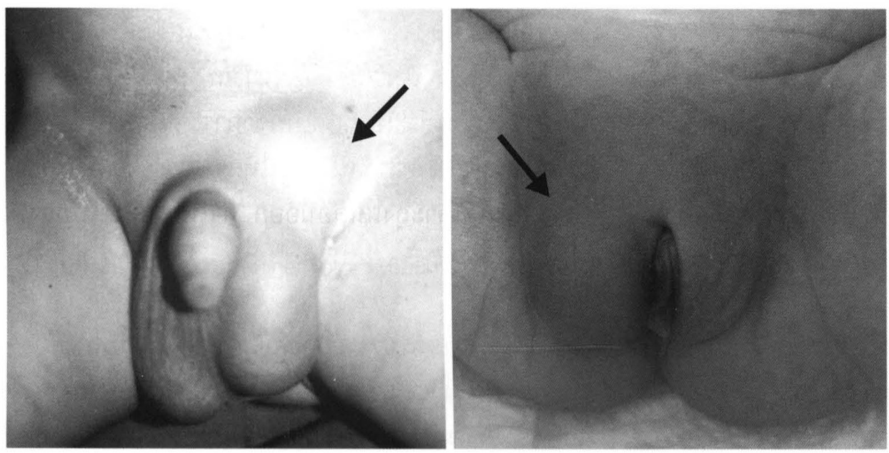
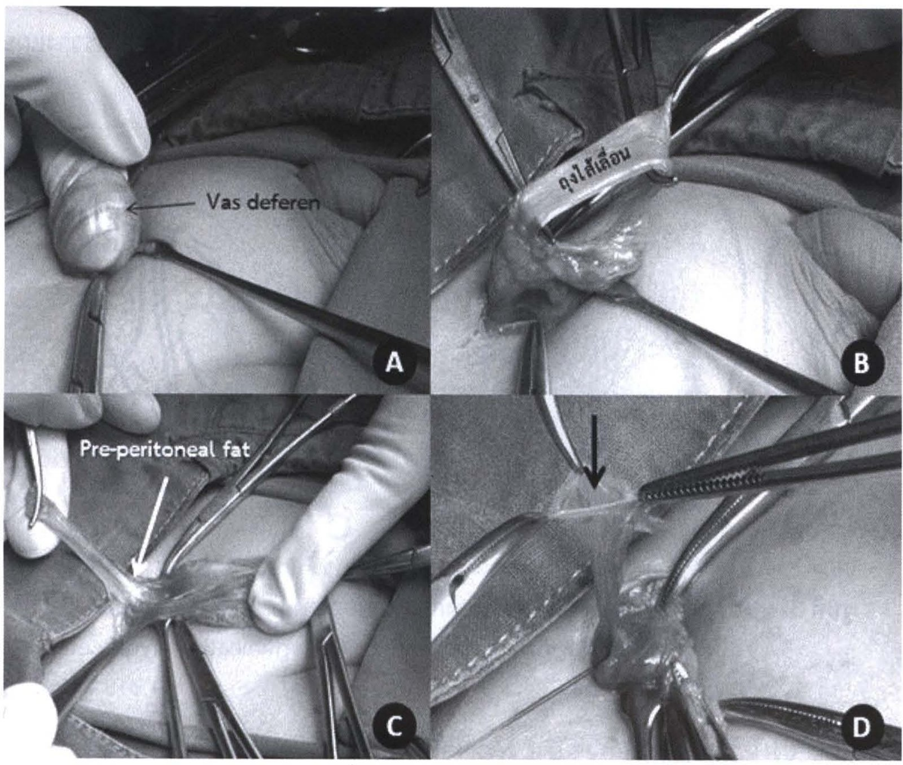
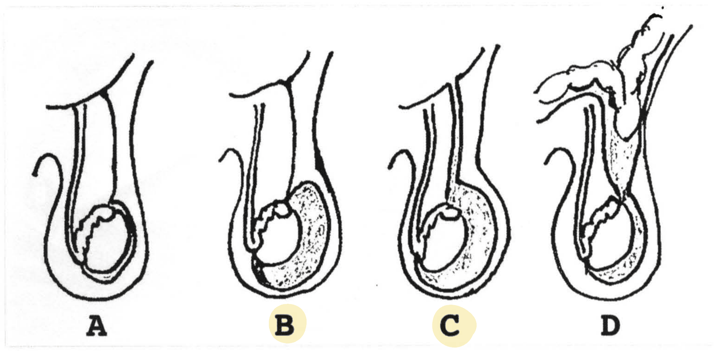
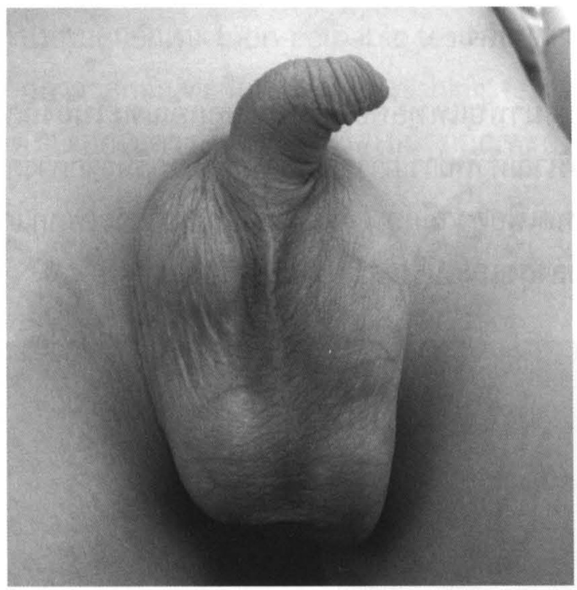
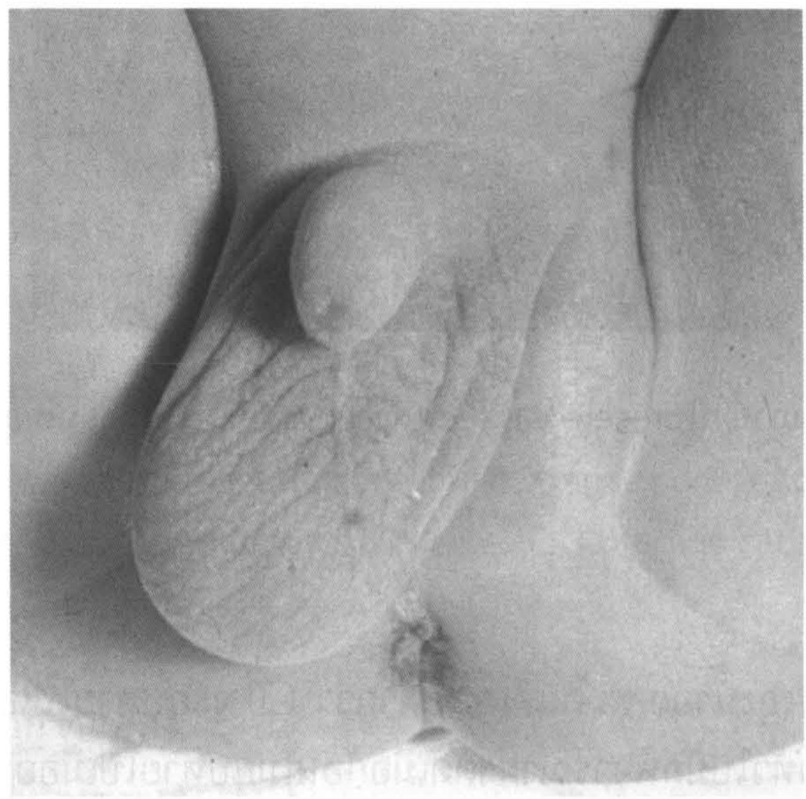
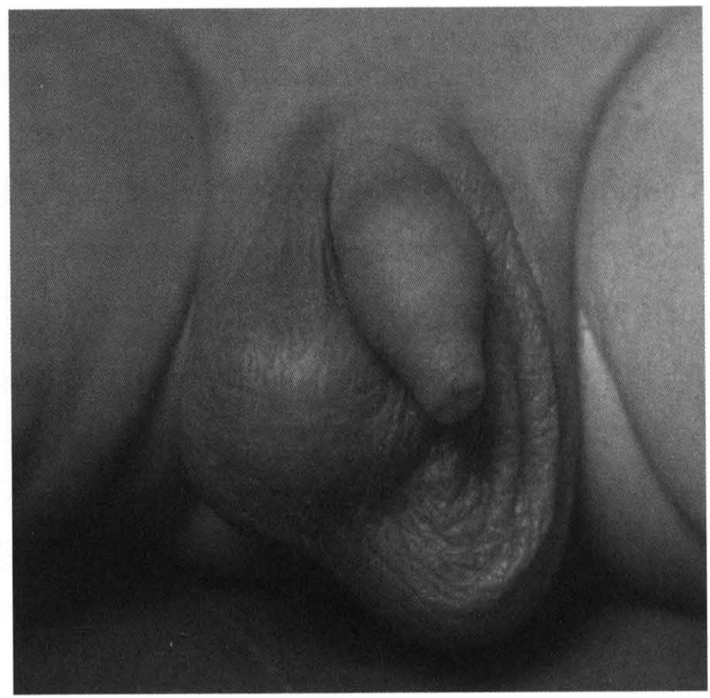
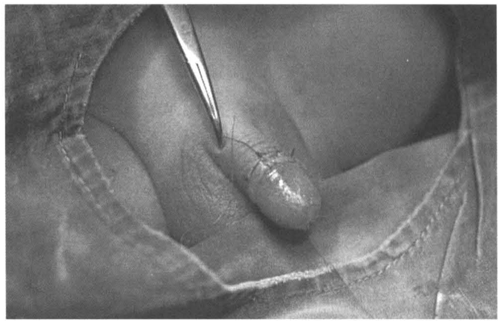
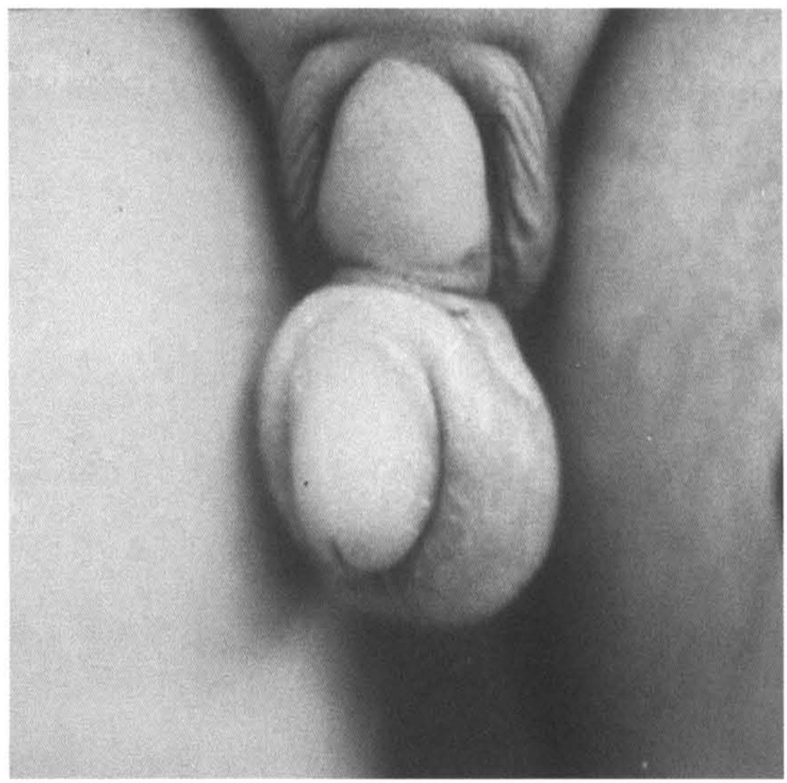

# ปัญหาบริเวณขาหนีบ และอัณฑะ (Inguinal region and scrotal problems)

## Contents of this file
- ไส้เลื่อนบริเวณขาหนีบ (inguinal hernia) (p.1012)
  - อาการและอาการแสดง (p.1013)
  - การวินิจฉัย (p.1013)
  - การรักษา (p.1014)
- ถุงน้ำอัณฑะ (hydrocele) (p.1015)
  - อาการและอาการแสดง (p.1016)
  - การรักษา (p.1017)
- อัณฑะค้างหรืออัณฑะไม่ลงถุง (undescended testis) (p.1017)
  - อาการและอาการแสดง (p.1018)
  - การรักษา (p.1019)
- อัณฑะบิด (testicular torsion) (p.1020)
  - อาการและอาการแสดง (p.1020)
  - การรักษา (p.1021)
- หนังหุ้มปลายอวัยวะเพศชายตีบ (phimosis) (p.1021)
- สรุป (p.1023)
- เอกสารอ้างอิง (p.1023)

<!-- p.1011 (printed none) -->
**ปัญหาบริเวณขาหนีบและอัณฑะ**

**Inguinal region and scrotal problems**

ประภาพรรณ รัชตะปีติ

<!-- p.1012 (printed 998) -->
**ปัญหาบริเวณขาหนีบและอัณฑะ**

**Inguinal region and scrotal problems**

ประภาพรรณ รัชตะปีติ

ปัญหาบริเวณขาหนีบและอัณฑะเป็นปัญหาที่พบบ่อยมากในคลินิกกุมารศัลยศาสตร์ การวินิจฉัยมักได้จากการซักประวัติและตรวจร่างกาย ซึ่งนำไปสู่การรักษาที่เหมาะสม บางโรคอาจหายได้โดยไม่ต้องผ่าตัดแต่บางภาวะก็ต้องการรักษาโดยการผ่าตัดอย่างรีบด่วน ปัญหาที่พบบ่อยและควรรู้ ได้แก่

- ไส้เลื่อนบริเวณขาหนีบ (indirect inguinal hernia)
- ถุงน้ำอัณฑะ (hydrocele)
- อัณฑะค้าง (undescended testis)
- อัณฑะบิด (testicular torsion)
- หนังหุ้มปลายอวัยวะเพศตีบ (phimosis)

## ไส้เลื่อนบริเวณขาหนีบ (inguinal hernia)1, 2

ไส้เลื่อนบริเวณขาหนีบเป็นภาวะที่ต้องรักษาด้วยการผ่าตัดที่พบได้บ่อยที่สุดภาวะหนึ่งในผู้ป่วยเด็ก พบได้ประมาณร้อยละ 5 ในทารกคลอดครบกำหนด และสูงขึ้นในทารกคลอดก่อนกำหนด พบในเด็กผู้ชายมากกว่าผู้หญิง 6-10 เท่า ประมาณ 2 ใน 3 ของผู้ป่วยพบไส้เลื่อนที่ขาหนีบข้างขวา พบเป็นทั้ง 2 ข้างได้ร้อยละ 10 ซึ่งพบมากกว่าในเพศหญิง มีรายงานการพบอุบัติการณ์สูงขึ้นในผู้มีประวัติไส้เลื่อนในเด็กในครอบครัวหรือแฝด

ไส้เลื่อนบริเวณขาหนีบในเด็กเกิดจากมีลำไส้หรืออวัยวะภายในช่องท้องเคลื่อนผ่านช่องเปิดใน inguinal anal เกิดจากการคงอยู่ของ processus vaginalis ซึ่งในภาวะปกติควรจะปิดไปหลังจากอัณฑะเคลื่อนลงมาอยู่ในถุงอัณฑะ (ประมาณเดือนที่ 7 ในครรภ์

<!-- p.1013 (printed 999) -->
มารดา) ชนิดของไส้เลื่อนที่พบบ่อยในเด็ก ได้แก่ indirect inguinal hernia แต่ในเพศหญิงอาจพบเป็น sliding hernia ซึ่งมีอวัยวะภายในเป็นส่วนหนึ่งของถุงไส้เลื่อน

### อาการและอาการแสดง

มักมาด้วยมีก้อนบริเวณขาหนีบหรือหัวหน่าวบางรายก้อนใหญ่มาถึงบริเวณถุงอัณฑะหรือบริเวณ labia ในเด็กผู้หญิง (รูปที่ 1) ก้อนมีขนาดเปลี่ยนแปลงหรือยุบเข้าออกได้ เช่น ขนาดใหญ่ขึ้นเมื่อเด็กร้องหรือเบ่ง เมื่อเด็กหลับก้อนอาจยุบลงเองหรือสามารถดันกลับเข้าในช่องท้องได้ เด็กมักไม่มีอาการผิดปกติอื่น ยกเว้นเกิดภาวะแทรกซ้อนไส้เลื่อนติดค้าง (incarcerated hernia) หรือลำไส้ขาดเลือด (strangulated hernia) เด็กจะมีอาการปวดร้องกวน อาจมีอาการของลำไส้อุดตัน ได้แก่ อาเจียน ท้องอืด ก้อนบริเวณขาหนีบแข็ง บวมแดง

> **Caption (verbatim):** รูปที่ 1 ไส้เลื่อนบริเวณขาหนีบในเด็ก เห็นก้อนบริเวณหัวหน่าวและเคลื่อนลงมาในถุงอัณฑะในเพศชาย หรือบริเวณ labia ในเพศหญิง (ลูกศรชี้)
> **Text in image (verbatim):** none
> **Description:** Two black-and-white clinical photographs side by side of infant groins, framed on the genital region only. Left: a boy; a bulge over the groin/pubic region (black arrow pointing to it at upper right) extends down into an enlarged scrotal half, which is swollen beside the penis. Right: a girl; a black arrow points to a swelling of the groin/labial region on one side above the vulva, with the labium on that side fuller than the other.
> **Identifiers in image:** none

### การวินิจฉัย

อาศัยประวัติและการตรวจร่างกายเป็นหลัก โดยดูตำแหน่งของก้อน สังเกตขนาดของก้อนว่ามีการเปลี่ยนแปลงเมื่อให้เด็กไอหรือเบ่ง หรือเมื่อเด็กร้องไห้หรือไม่ การคลำพบก้อนนุ่ม หรือขดลำไส้ในถุงไส้เลื่อน อาจลองดันก้อนกลับเข้าในช่องท้อง ลูบบริเวณ pubic tubercle จะได้ความรู้สึกลื่น (silk sign) ของถุงไส้เลื่อนและส่วนประกอบใน spermatic

<!-- p.1014 (printed 1000) -->
cord ในเด็กผู้ชายควรตรวจตำแหน่งของอัณฑะเพื่อประเมินว่ามีภาวะอัณฑะค้างร่วมด้วยหรือไม่ ในเด็กผู้หญิงที่เป็น sliding hernia อาจคลำได้ก้อนลักษณะกลมบริเวณขาหนีบเนื่องจากมี ovary อยู่ในถุงไส้เลื่อน การตรวจทุกครั้งต้องประเมินว่ามีภาวะรีบด่วน ได้แก่ ภาวะไส้เลื่อนค้าง หรือลำไส้ขาดเลือดหรือไม่

### การรักษา3, 4

เนื่องจากภาวะไส้เลื่อนขาหนีบไม่สามารถหายได้เอง ในเด็กที่ไม่มีข้อห้ามอื่นในการผ่าตัด แนะนำให้รักษาด้วยการผ่าตัด elective surgery ภายใน 2-4 สัปดาห์หลังได้รับการวินิจฉัย ไม่ควรรอนานเพราะอาจเกิดภาวะไส้เลื่อนค้างและอาจทำให้ลำไส้ขาดเลือดได้ การผ่าตัดรักษาไส้เลื่อนบริเวณขาหนีบในเด็กไม่จำเป็นต้องทำ herniorrhaphy เหมือนในผู้ใหญ่เพราะในเด็กเป็นความผิดปกติแต่กำเนิด ไม่ได้มีความอ่อนแอของผนังหน้าท้อง การผ่าตัดทำโดยตัดถุงไส้เลื่อนออก (herniotomy) และผูก processus vaginalis ที่บริเวณ internal inguinal ring เพื่อป้องกันการเกิดเป็นซ้ำ (รูปที่ 2) ปัจจุบันการผ่าตัดด้วยกล้องส่องมีบทบาทมากขึ้น ข้อดีคือเห็น internal ring ทั้ง 2 ข้าง สามารถประเมินว่ามี patent processus vaginalis ในด้านที่ไม่มีอาการหรือไม่ ในรายที่เป็นซ้ำการผ่าตัดด้วยกล้องส่องทำให้หลีกเลี่ยงการผ่าตัดผ่านบริเวณแผลเดิม ซึ่งอาจมีพังผืดทำให้ผ่าตัดแบบเปิดทำได้ยาก ข้อเสียคือการผ่าตัดด้วยกล้องส่องมักไม่ได้เลาะถุงไส้เลื่อนออก ทำให้อาจเกิดเป็นถุงน้ำ (hydrocele) ภายหลังได้

<!-- p.1015 (printed 1001) -->

> **Caption (verbatim):** รูปที่ 2 ภาพการผ่าตัด herniotomy (เอื้อเฟื้อรูปภาพประกอบโดย นพ. ไพศาล เวชชพิพัฒน์)
> **Text in image (verbatim):** Vas deferen · ถุงไส้เลื่อน · Pre-peritoneal fat · A · B · C · D
> **Description:** Four black-and-white intra-operative photographs (panels A-D) of an open inguinal herniotomy in a child, operative field draped, gloved fingers and fine instruments (forceps, haemostats, scissors) visible. A: a gloved finger holds the cord structures lifted out of the wound; a thin arrow labelled "Vas deferen" points to the vas on the cord. B: a forceps holds up the separated hernia sac, labelled "ถุงไส้เลื่อน" on the sac, with tissue below it. C: the sac is dissected up to its neck, held by haemostats; a white arrow labelled "Pre-peritoneal fat" points to the fat at the neck of the sac. D: the sac is twisted and held with haemostats at its base, and a black arrow points down to the high neck of the sac at the level where it is ligated, a forceps holding tissue beside it.
> **Identifiers in image:** none

หากพบว่ามีภาวะไส้เลื่อนค้าง ควรรีบทำการรักษา โดยพยายามดันก้อนกลับเข้าช่องท้องหลังจากให้ยานอนหลับ หากดันกลับได้ แนะนำให้สังเกตอาการในโรงพยาบาลและทำผ่าตัด herniotomy ภายใน 2-3 วันต่อมา หากสงสัยภาวะลำไส้ขาดเลือด ไม่ควรดันพยายามดันก้อนกลับ และจำเป็นต้องทำการผ่าตัดฉุกเฉินก่อนที่ลำไส้จะเน่าตายหรือแตกทะลุ

## ถุงน้ำอัณฑะ (hydrocele)

ถุงน้ำอัณฑะมีกลไกการเกิดคล้ายกับไส้เลื่อนขาหนีบในเด็ก คือ การคงอยู่ของ processus vaginalis แต่มีเพียง peritoneal fluid อยู่ภายในถุง พบถุงน้ำได้หลายตำแหน่งตามแนวการเคลื่อนของ processus vaginalis สามารถแบ่งตามตำแหน่งได้เป็น vaginal

*[handwritten reader note omitted]*

<!-- p.1016 (printed 1002) -->
*[handwritten reader note omitted]*

hydrocele หรือ hydrocele ของ spermatic cord แต่การแบ่งที่มีผลต่อการวางแผนการรักษาคือดูว่ามีการติดต่อของถุงน้ำกับช่องท้องหรือไม่ (รูปที่ 3)

> **Caption (verbatim):** รูปที่ 3 ภาพแสดงความผิดปกติที่เกี่ยวข้องกับการคงอยู่ของ processus vaginalis A: Normal, B: Vaginal hydrocele, C: Communicating hydrocele, D: Inguinal hernia
> **Text in image (verbatim):** A · B · C · D
> **Description:** Four schematic line drawings side by side of a testis within the scrotum with the spermatic cord and processus vaginalis running up to the abdominal wall (the curved line at top). A (Normal): the processus vaginalis is obliterated above the testis; only a thin tunica vaginalis surrounds the testis, no fluid. B (Vaginal hydrocele): a stippled fluid collection surrounds the testis within the tunica vaginalis, with the processus above closed off. C (Communicating hydrocele): the stippled fluid around the testis continues upward as a narrow stippled patent channel along the cord toward the abdomen. D (Inguinal hernia): a loop of bowel passes from the abdomen down into a wide patent processus vaginalis along the cord, above the testis.
> **Identifiers in image:** none

### อาการและอาการแสดง

ผู้ปกครองมักพามาด้วยอาการอัณฑะมีขนาดไม่เท่ากัน โดยไม่มีอาการร่วมอื่น การตรวจร่างกายสามารถวินิจฉัยและแยกชนิดของถุงน้ำได้ไม่ยาก vaginal hydrocele เป็นถุงน้ำชนิดที่พบได้บ่อยที่สุด โดยถุงน้ำจะหุ้มรอบอัณฑะ ทำให้คลำแยกจากลูกอัณฑะได้ไม่ชัดเจน ส่วน hydrocele ของ spermatic cord ถุงน้ำจะอยู่เหนือตำแหน่งอัณฑะปกติ ดูภายนอกคล้ายมีอัณฑะมากกว่า 2 ใบ (รูปที่ 4) คลำแยกจากลูกอัณฑะได้ง่าย หากเป็นถุงน้ำชนิดที่มีทางเชื่อมกับช่องท้อง (communicating hydrocele) อาจให้ประวัติว่าก้อนมีขนาดเล็กลงได้เมื่อนอนราบ ซึ่งอาจสับสนกับภาวะไส้เลื่อนบริเวณขาหนีบได้

การคลำบริเวณก้อนจะพบก้อนถุงน้ำมีลักษณะ cystic consistency สามารถคลำเหนือก้อนได้ การตรวจ trans illumination โดยใช้ไฟฉายส่องแนบบริเวณถุงน้ำให้ผลบวก หากเป็นชนิด non-communicating จะไม่สามารถดันก้อนกลับเข้าช่องท้องได้

<!-- p.1017 (printed 1003) -->

> **Caption (verbatim):** รูปที่ 4 แสดงภาพ hydrocele ของ spermatic cord ที่เห็นเป็นก้อนในถุงอัณฑะด้านบนทั้ง 2 ข้าง
> **Text in image (verbatim):** none
> **Description:** Black-and-white clinical photograph of an infant's external genitalia viewed from the front, framed on the genital region only. The penis curves upward at the top; the scrotum below is enlarged, with rounded swellings in the upper part of the scrotum on both sides in addition to the lower scrotal contour, giving an appearance of more than two masses in the scrotum.
> **Identifiers in image:** none

### การรักษา3

ร้อยละ 90 ของถุงน้ำอัณฑะในเด็กอายุต่ำกว่า 1 ปี จะยุบหายไปเอง จึงไม่จำเป็นต้องรีบผ่าตัดรักษา โดยทั่วไปมักพิจารณาผ่าตัดเมื่อก้อนไม่ยุบหายไปเมื่ออายุ 1-2 ปี แต่หากพบเป็น communicating hydrocele แม้ช่องทางติดต่อกับช่องท้องจะมีขนาดเล็กแต่ก็อาจจะมีลำไส้หรืออวัยวะอื่นเคลื่อนผ่านมาเมื่อใดก็ได้ จึงแนะนำให้ทำการผ่าตัดเป็น elective surgery เมื่อวินิจฉัยได้ การผ่าตัดรักษาถุงน้ำอัณฑะ ได้แก่ hydrocelectomy และผูกปิด processus vaginalis หากยังมีทางเชื่อมต่อ คล้ายกับการผ่าตัดไส้เลื่อนบริเวณขาหนีบในเด็ก

## อัณฑะค้างหรืออัณฑะไม่ลงถุง (undescended testis)5, 6

อัณฑะค้าง (undescended testis หรือ cryptorchidism) คือภาวะที่ลูกอัณฑะไม่เคลื่อนลงไปในถุง หรืออยู่ผิดที่ พบได้ประมาณร้อยละ 3-5 ของเด็กคลอดครบกำหนด ในภาวะปกติลูกอัณฑะจะเคลื่อนจากตำแหน่งหลังช่องท้อง (retroperitoneum) มาถึงถุงอัณฑะในสัปดาห์ที่ 35 ของทารกในครรภ์และยังมีการเคลื่อนตัวลงต่อได้จนถึงระยะหลังคลอด 3-4 เดือน

<!-- p.1018 (printed 1004) -->
### อาการและอาการแสดง

อาการแสดงที่นำมาพบแพทย์คือคลำไม่พบลูกอัณฑะในถุงอัณฑะ ถุงอัณฑะแฟบ (รูปที่ 5) หรือมีก้อนบริเวณหัวหน่าว การตรวจร่างกายควรเริ่มจากการดูลักษณะทั่วไปบริเวณขาหนีบและอวัยวะเพศเพื่อดูว่ามีก้อน หรือมีลักษณะอวัยวะเพศกำกวมหรือไม่ การคลำหาลูกอัณฑะข้างที่ไม่ลงถุงและเปรียบเทียบขนาดกับข้างปกติ

> **Caption (verbatim):** รูปที่ 5 ภาพผู้ป่วยมีอัณฑะค้างข้างซ้าย เห็นถุงอัณฑะแฟบ
> **Text in image (verbatim):** none
> **Description:** Black-and-white clinical photograph of an infant's perineum and genitalia viewed from below with the thighs apart, framed on the genital region only. The penis is at the top centre. One hemiscrotum (on the viewer's left) is full and rugose, containing a testis; the other hemiscrotum (on the viewer's right, the patient's left side) is flat and empty-looking. The anus is visible at the bottom.
> **Identifiers in image:** none

การตรวจร่างกายไม่พบลูกอัณฑะในถุงอัณฑะอาจเกิดได้หลายสาเหตุ ได้แก่

*[handwritten reader note omitted]*

- ลูกอัณฑะถูกดึงรั้ง (retractile testis) มักคลำพบลูกอัณฑะบริเวณขาหนีบ หรืออยู่ค่อนข้างสูงในถุงอัณฑะ อาจมีประวัติเห็นลูกอัณฑะเคลื่อนต่ำลงเมื่อเด็กหลับหรือสามารถจับลูกอัณฑะลงมาในตำแหน่งปกติได้ ภาวะนี้เกิดจากการดึงรั้งของกล้ามเนื้อ cremasteric มักหายได้เองเมื่อเข้าสู่วัย puberty
- ลูกอัณฑะอยู่ผิดที่ (ectopic testis) อาจพบลูกอัณฑะอยู่บริเวณ perineum หรือลงไปอยู่ในถุงอัณฑะด้านตรงข้าม (cross ectopia testis)
- ลูกอัณฑะค้างจริง (true undescended testis) เป็นภาวะที่ลูกอัณฑะหยุดค้างอยู่ระหว่างการเลื่อนลงมาจากช่องท้อง โดยอาจค้างอยู่ในช่องท้อง หรือใน inguinal canal

<!-- p.1019 (printed 1005) -->
*[handwritten reader note omitted]*

- ในกรณีคลำไม่พบลูกอัณฑะ (non-palpable testis) นอกจาก intraabdominal testis ยังอาจเกิดจากภาวะลูกอัณฑะฝ่อหายไป (vanishing testis) ซึ่งอาจเกิดจากการลูกอัณฑะขาดเลือดตั้งแต่อยู่ในครรภ์มารดา หรือไม่มีลูกอัณฑะตั้งแต่แรก (testicular agenesis)

### การรักษา

ภาวะลูกอัณฑะค้างจำเป็นต้องได้รับการรักษาเนื่องจากมีความเสี่ยงต่อภาวะต่างๆ ได้แก่

- การเกิดไส้เลื่อนบริเวณขาหนีบ เนื่องจากมีการคงอยู่ของ processus vaginalis
- ภาวะลูกอัณฑะบิด (testicular torsion) มักเป็นชนิด extravaginal จากการที่ guberculum หย่อน
- อาจเป็นหมันหรือมีบุตรยาก เนื่องจากลูกอัณฑะอยู่ในอุณหภูมิที่ไม่เหมาะสม
- อัตราการเกิดเนื้องอกของอัณฑะสูงกว่าเด็กปกติ โดยพบว่าขึ้นกับตำแหน่งที่อัณฑะค้าง
- เกิดการบาดเจ็บได้ง่าย โดยเฉพาะลูกอัณฑะที่ค้างบริเวณขาหนีบ
- อาจมีผลกระทบด้านจิตใจของเด็ก

การผ่าตัดจะขจัดความเสี่ยงที่กล่าวถึงข้างต้น ยกเว้นจะไม่ลดความเสี่ยงในการเกิดเนื้องอกอัณฑะ แต่มีข้อดีคือสามารถตรวจติดตามได้ง่ายจากการคลำบริเวณถุงอัณฑะ โดยการผ่าตัดรักษาแนะนำให้ทำในช่วงอายุ 6-18 เดือน ในเด็กคลอดครบกำหนด เนื่องจากหลังคลอด 6 เดือนแรกอัณฑะอาจเคลื่อนลงมาได้เอง หลักการผ่าตัดคือการนำลูกอัณฑะลงมาอยู่ในถุงอัณฑะ กรณีที่คลำลูกอัณฑะได้บริเวณขาหนีบหรือหัวหน่าว มักจะสามารถผ่าตัดผ่านแผลบริเวณขาหนีบได้ แต่หากคลำไม่พบลูกอัณฑะควรตรวจเพิ่มเติมด้วยคลื่นเสียงความถี่สูงเพื่อหาตำแหน่งของลูกอัณฑะและวางแผนการผ่าตัด ถ้าลูกอัณฑะค้างอยู่ในช่องท้องอาจต้องอาศัยการผ่าตัดด้วยกล้องส่องเพื่อหาลูกอัณฑะและดึงลงมาในถุง

<!-- p.1020 (printed 1006) -->
## อัณฑะบิด (testicular torsion)7, 8

อัณฑะบิดเกิดจากการบิดหมุนของ spermatic cord ทำให้รบกวนการไหลเวียนของเส้นเลือดภายใน cord ทำให้เกิด venous congestion และลูกอัณฑะเกิดการขาดเลือดตามมา

### อาการและอาการแสดง

อัณฑะบิดพบได้บ่อยในกลุ่มอายุต่ำกว่า 3 ปี และกลุ่มวัยรุ่น ในกลุ่มวัยรุ่นผู้ป่วยมักมาด้วยอาการปวดฉับพลันบริเวณอัณฑะ อาจมีอาการคลื่นไส้ อาเจียนร่วมด้วย การตรวจร่างกายพบอัณฑะข้างที่ปวดยกสูงขึ้น อาจสังเกตเห็นลูกอัณฑะอยู่ในแนวขวาง (รูปที่ 6) การพยุงลูกอัณฑะขึ้นมักเพิ่มความเจ็บปวด (Prehn sign เป็นบวก) มีการลดลงของ cremasteric reflex การตรวจร่างกายเพียงอย่างเดียวอาจแยกภาวะอัณฑะบิดจาก orchitis ได้ยากโดยเฉพาะในรายที่มีอาการมานาน อาจต้องอาศัยการตรวจเพิ่มเติม เช่น การตรวจพบเม็ดเลือดขาวในปัสสาวะอาจบ่งถึงภาวะ orchitis มากกว่า

การตรวจที่เป็นมาตรฐานในการวินิจฉัยภาวะแยกระหว่าง 2 ภาวะดังกล่าว ได้แก่ Doppler ultrasonography ซึ่งในกรณี testicular torsion จะพบว่า spermatic cord มีการบิดตัว และยังสามารถช่วยบอกได้ว่าลูกอัณฑะมีภาวะขาดเลือดหรือไม่

> **Caption (verbatim):** รูปที่ 6 ภาพผู้ป่วยอัณฑะบิดข้างขวา พบอัณฑะยกสูงขึ้นและอยู่ในแนวขวาง
> **Text in image (verbatim):** none
> **Description:** Black-and-white clinical photograph of a child's external genitalia viewed from the front, framed on the genital region only. The penis is at the centre. The scrotum is asymmetric: one hemiscrotum (on the viewer's left, the patient's right side) is swollen and rounded and sits higher, with the testis lying in a more horizontal orientation, while the other hemiscrotum hangs lower with rugose skin.
> **Identifiers in image:** none

<!-- p.1021 (printed 1007) -->
### การรักษา

ควรทำการผ่าตัดฉุกเฉินเมื่อวินิจฉัยได้ หรือในกรณีที่ไม่สามารถแยกภาวะนี้ออกได้ชัดเจน เนื่องจากหากผ่าตัดช้ามีโอกาสที่อัณฑะจะเน่าและไม่สามารถเก็บรักษาไว้ได้ โดยทั่วไปหากสามารถรักษาภายใน 6 ชั่วโมง อัณฑะจะมีโอกาสรอดมากกว่าร้อยละ 90 การผ่าตัดทำโดยเปิดแผลบริเวณถุงอัณฑะเข้าไปหมุนลูกอัณฑะ (detorsion) และเย็บยึดกับผนังด้านในของถุงอัณฑะ ทั้งนี้ควรทำในด้านตรงข้ามด้วย เนื่องจากพบว่าอัณฑะบิดในเด็กมักเกี่ยวข้องกับ anatomy ที่ผิดปกติซึ่งมักพบทั้ง 2 ข้าง หากพบว่าอัณฑะเน่าตายแล้วแนะนำให้ตัดออก เนื่องจากที่หากปล่อยทิ้งไว้ร่างกายอาจสร้าง autoimmune ขึ้นและเป็นอันตรายต่อลูกอัณฑะด้านตรงข้าม (immune-mediated orchitis) ในกรณีไม่สามารถผ่าตัดได้ทันทีอาจพิจารณาทำ manual detorsion โดยหมุนอัณฑะออกทางด้านนอก (lateral) เพื่อลดระยะเวลาที่อัณฑะขาดเลือดไปเลี้ยง

## หนังหุ้มปลายอวัยวะเพศชายตีบ (phimosis)

ภาวะหนังหุ้มปลายอวัยวะเพศชายตีบ หรือ phimosis คือภาวะที่ไม่สามารถเปิด foreskin ของอวัยวะเพศออกจนเห็น glans penis ได้ เป็นภาวะปกติที่พบได้ในทารกแรกเกิด (physiologic phimosis) และมักจะเปิดได้เองเมื่ออายุ 3-5 ปี

ลักษณะที่ phimosis ทำให้เกิดพยาธิสภาพที่ต้องแก้ไขหรือข้อบ่งชี้ในการผ่าตัดขลิบหนังหุ้มปลายอวัยวะเพศ ได้แก่

- การอักเสบบริเวณหนังหุ้มปลาย (posthitis)
- มีการสะสมของขี้เปียก (smegma)
- การตีบรุนแรง ปัสสาวะลำบาก บางรายผู้ปกครองสังเกตว่ามีโป่งพองบริเวณหนังหุ้มปลายขณะปัสสาวะ (ballooning)
- หากเด็กมีประวัติติดเชื้อทางเดินปัสสาวะพบร่วมกับมีภาวะ phimosis
- หนังหุ้มปลายยาว เปิดทำความสะอาดได้ลำบาก
- paraphimosis มักพบในเด็กที่มีภาวะ phimosis อยู่ก่อน เมื่อรูดเปิดหนังหุ้มปลายแล้วไม่สามารถรูดกลับได้ ทำให้รัดจนอวัยวะเพศบวม จะมีอาการปวดมาก
- ความเชื่อทางศาสนา

<!-- p.1022 (printed 1008) -->
การผ่าตัดทำโดยตัดหนังหุ้มปลายส่วนที่ยาวเกินออก และเย็บหนังหุ้มปลายเข้ากับผิวหนังของ penile shaft (รูปที่ 7)

> **Caption (verbatim):** รูปที่ 7 การผ่าตัด circumcision
> **Text in image (verbatim):** none
> **Description:** Black-and-white intra-operative photograph of a circumcision in a child, the penis exposed through a fenestrated surgical drape. The foreskin has been excised and the glans is exposed; a line of fine interrupted sutures joins the cut edge of the inner foreskin to the skin of the penile shaft just behind the glans. A fine instrument (forceps/needle holder) enters from the top and touches the suture line.
> **Identifiers in image:** none

ในภาวะ paraphimosis ควรพยายามรูดหนังหุ้มปลายกลับเพื่อให้ยุบบวมก่อน หากทำไม่สำเร็จพิจารณาทำ dorsal split เพื่อคลายการรัด และผ่าตัดขลิบหลังจากยุบบวมแล้ว (รูปที่ 8)

> **Caption (verbatim):** รูปที่ 8 paraphimosis
> **Text in image (verbatim):** none
> **Description:** Black-and-white clinical photograph of a child's penis between the thighs, framed on the genital region only. The foreskin has been retracted behind the glans and remains there as a markedly swollen, oedematous, smooth ring of tissue encircling and constricting the penis, with the glans exposed beyond it.
> **Identifiers in image:** none

<!-- p.1023 (printed 1009) -->
หากพบเด็กมีลักษณะ buried penis หรือ concealed penis คือการที่ penile shaft ถูกดึงรั้งโดย suspensory ligament ห้ามทำการขลิบหนังหุ้มปลายด้วยวิธีที่ใช้ทั่วไป เพราะผิวหนังบริเวณ penile shaft มีน้อย ต้องทำผ่าตัดด้วยวิธี degloving circumcision โดยเลาะระหว่างหนังหุ้มปลายไปจนถึง Buck’s fascia เพื่อให้องคชาติไม่ถูกดึงรั้ง พยายามไม่ตัดหนังหุ้มปลายทิ้ง และเย็บกลับมาคลุม penile shaft การผ่าตัดนี้ไม่ควรทำเมื่อเด็กมีอายุมากกว่า 2 ปี เนื่องจากพบว่าเมื่อเด็กโตขึ้นความรุนแรงของพยาธิสภาพอาจน้อยลงเพราะ ไขมันบริเวณ suprapubic บางลง9

## สรุป

ปัญหาบริเวณขาหนีบ และอัณฑะเป็นภาวะที่พบได้บ่อยทางทางกุมารศัลยศาสตร์ การวินิจฉัยทำได้ไม่ยากด้วยการซักประวัติและตรวจร่างกาย ภาวะที่ต้องการรักษาฉุกเฉิน ได้แก่ ไส้เลื่อนค้าง โดยเฉพาะในรายที่มีลำไส้ขาดเลือด ภาวะลูกอัณฑะบิด และภาวะ paraphimosis ส่วนภาวะที่อาจหายได้เองเมื่ออายุมากขึ้น ได้แก่ hydrocele และ phimosis

## เอกสารอ้างอิง

1. Chandler NM, Danielson PD. Inguinal Hernia and Hydrocele. In: Mattei P, Nichol P, Rollins II M, Muratore C, editors. Fundamentals of Pediatric Surgery. 2 ed: Springer, Cham; 2017. p. 725-31.
2. Synder CL, Escolino M, Esposito C. Inguinal hernia. In: Holcomb III GW, Murphy JP, St.Peter SD, editors. Holcomb and Ashcraft’s pediatric surgery. 7 ed. London: Elsevier; 2019. p. 784-804.
3. Esposito Ciro, Escolino Maria, Turrà Francesco, Roberti Agnese, Cerulo Mariapina, Farina Alessandra, et al. Current concepts in the management of inguinal hernia and hydrocele in pediatric patients in laparoscopic era. Seminars in Pediatric Surgery. 2016;25(4):232-40.
4. Abdulhai SA, Glenn IC, Ponsky TA. Incarcerated pediatric hernias. Surg Clin North Am. 2017;97(1):129-45.

<!-- p.1024 (printed 1010) -->
5. Elder JS. Surgical Management of the Undescended Testis: Recent Advances and Controversies. Eur J Pediatr Surg. 2016;26(5):418-26.
6. Hutson JM, Vikraman J, Li R, Thorup J. Undescended testis: What paediatricians need to know. J Paediatr Child Health. 2017;53(11):1101-4.
7. Bowlin PR, Gatti JM, Murphy JP. Pediatric Testicular Torsion. Surg Clin North Am. 2017;97(1):161-72.
8. Axt J, Gatti JM. The acute scrotum. In: Holcomb III GW, Murphy JP, St.Peter SD, editors. Holcomb and Ashcraft’s pediatric surgery. 7 ed. London: Elsevier; 2019. p. 821-6.
9. Nelson ED. Penile Anomalies and Circumcision. In: Mattei P, Nichol P, Rollins II M, Muratore C, editors. Fundamentals of Pediatric Surgery. 2 ed: Springer, Cham; 2017. p. 711-24.
