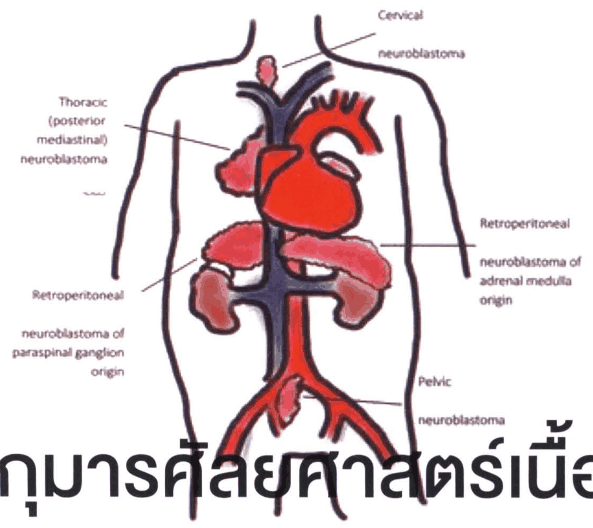
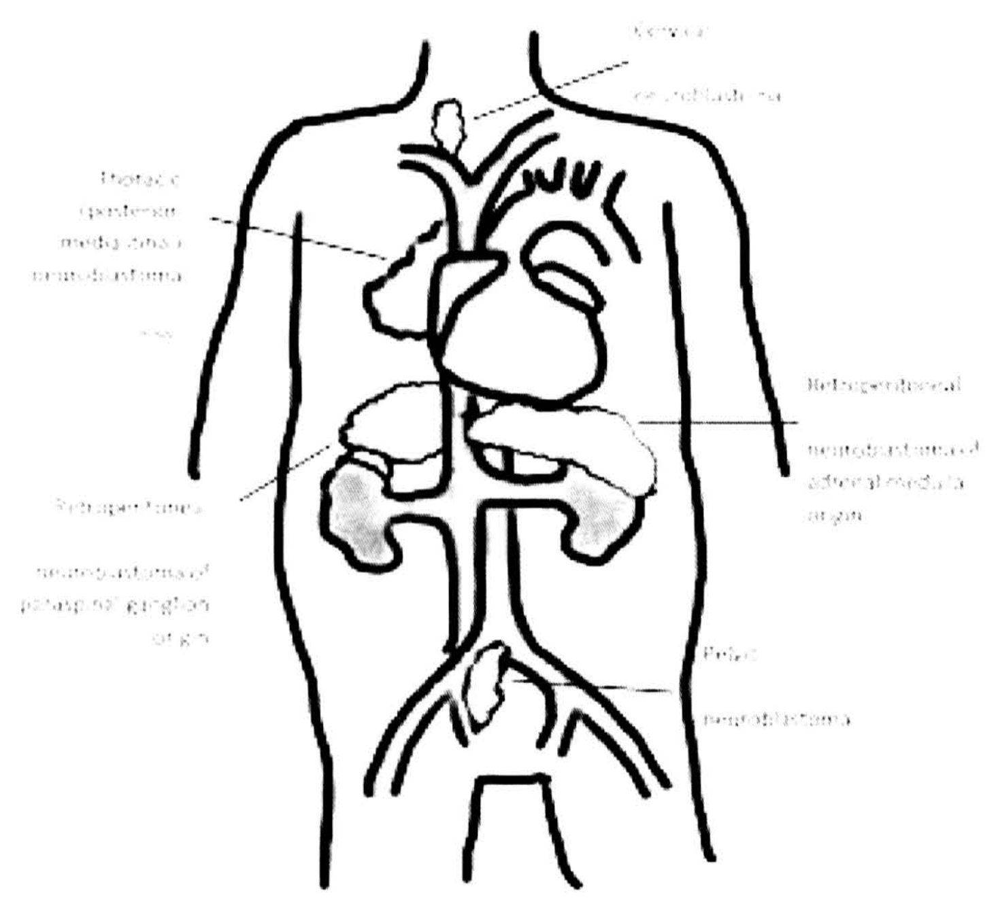
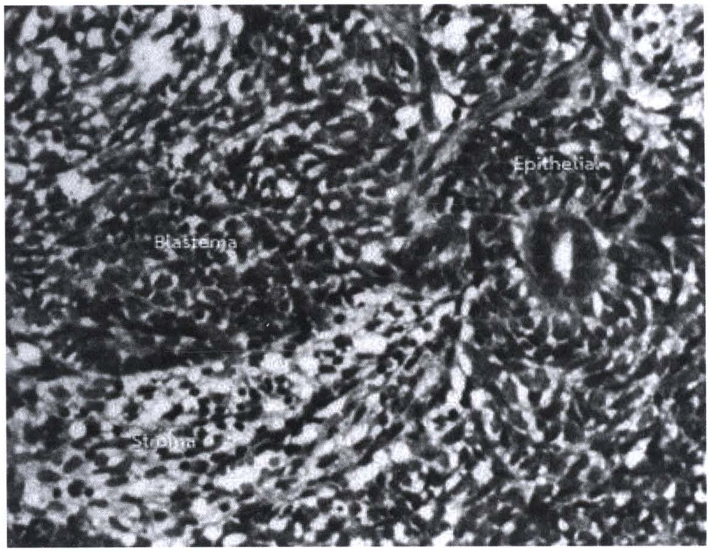
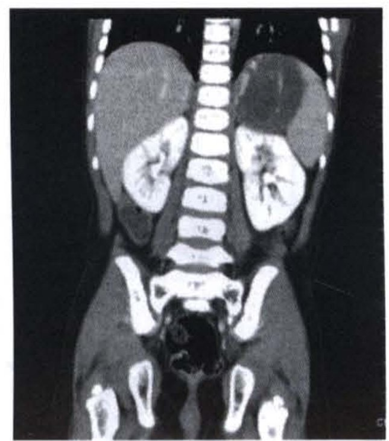
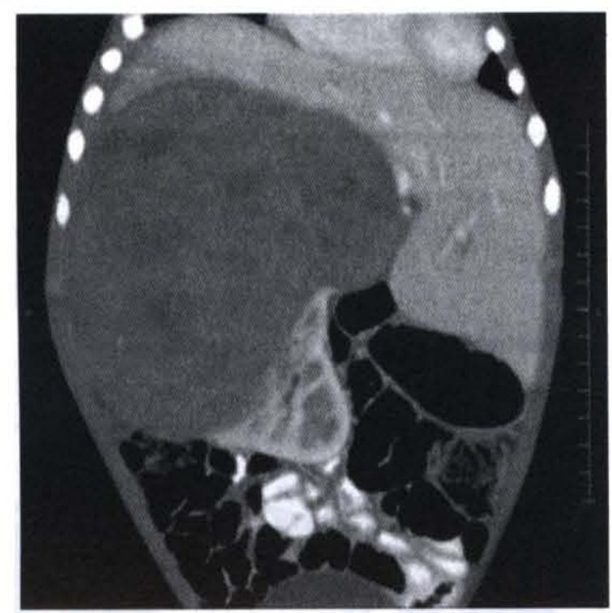
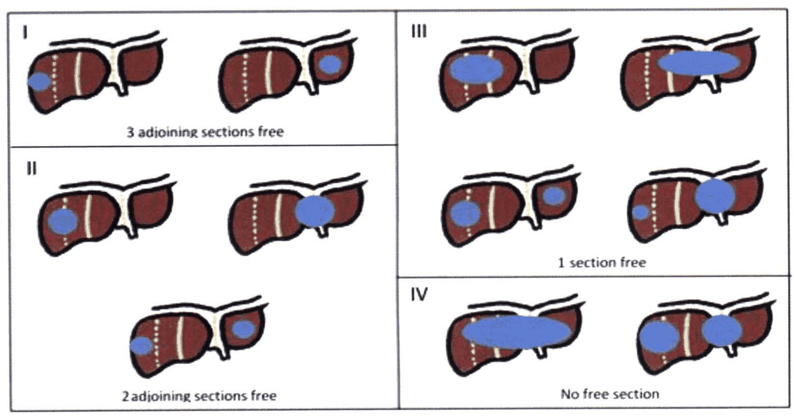
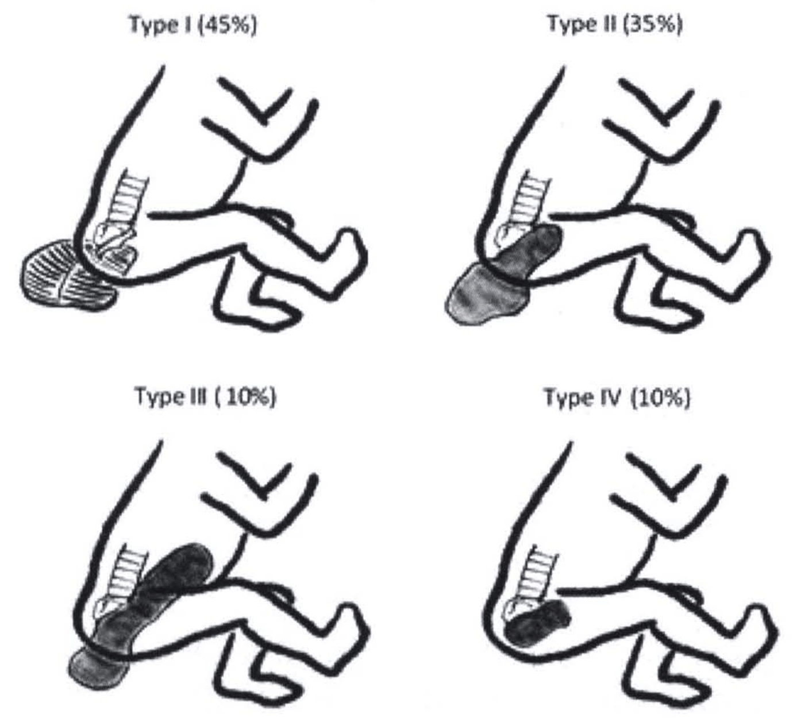
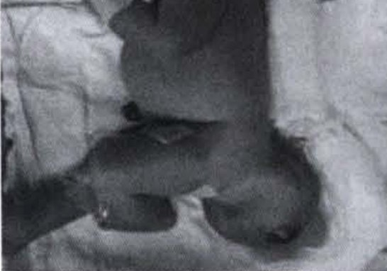
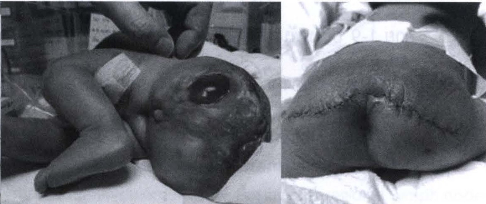

# กุมารศัลยศาสตร์เนื้องอก (Pediatric Surgical Oncology)

## Contents of this file
- เนื้องอก Neuroblastoma (p.1026)
- เนื้องอก Wilms (p.1031)
- เนื้องอก Hepatoblastoma (p.1035)
- เนื้องอก Teratoma (p.1038)
- เนื้องอก Rhabdomyosarcoma (p.1040)
- บทสรุป (p.1042)
- เอกสารอ้างอิง (p.1043)

<!-- p.1025 (printed none) -->
**กุมารศัลยศาสตร์เนื้องอก**

**Pediatric Surgical Oncology**

นิมมิตา ศรีสันต์

> **Caption (verbatim):** none
> **Text in image (verbatim):** Cervical neuroblastoma · Thoracic (posterior mediastinal) neuroblastoma · Retroperitoneal neuroblastoma of adrenal medulla origin · Retroperitoneal neuroblastoma of paraspinal ganglion origin · Pelvic neuroblastoma
> **Description:** Coloured hand-drawn decorative illustration behind the chapter title. A black outline of a child's trunk (neck, shoulders, torso, upper thighs) contains a red heart with aortic arch, the red aorta descending and dividing into iliac arteries, the blue superior vena cava/brachiocephalic veins and inferior vena cava with renal veins, two brown kidneys, and pink irregular masses marking neuroblastoma locations. Leader lines point from labels to the pink masses: a small mass at the root of the neck (Cervical neuroblastoma); a mass beside the heart on the patient's right in the posterior mediastinum (Thoracic (posterior mediastinal) neuroblastoma); a mass above the left kidney (Retroperitoneal neuroblastoma of adrenal medulla origin); a mass above the right kidney beside the vessels (Retroperitoneal neuroblastoma of paraspinal ganglion origin); a small mass at the aortic bifurcation in the pelvis (Pelvic neuroblastoma). A small stray mark appears under the thoracic label. The lower part of the chapter title text overlaps the drawing.
> **Identifiers in image:** none

<!-- p.1026 (printed 1012) -->
**กุมารศัลยศาสตร์เนื้องอก**

**Pediatric Surgical Oncology**

นิมมิตา ศรีสันต์

อุบัติการณ์โรคมะเร็งในเด็กพบได้น้อยเมื่อเทียบกับผู้ใหญ่ โดยผู้ป่วยเด็กคิดเป็น 2% ของผู้ป่วยด้วยโรคมะเร็งทั้งหมด แต่เป็นสาเหตุของการเสียชีวิตคิดเป็นอันดับ 2 รองจากภาวะบาดเจ็บ ในเด็กอายุ 1-14 ปี1 ปัจจุบันการศึกษาวิจัยด้านพันธุศาสตร์ ชีววิทยาระดับโมเลกุล และมะเร็งวิทยา ส่งผลให้มีการพัฒนาเครื่องมือในการรักษาโรคมะเร็งได้ต่อเนื่องและมีประสิทธิภาพ ความก้าวหน้าในการรักษาโรคมะเร็งในเด็กทำให้อัตราการเสียชีวิตจากโรคมะเร็งลดลงจากเดิมอย่างมาก ซึ่งเป็นผลสืบเนื่องจากการร่วมรักษาทั้งยาเคมีบำบัด รังสีรักษา และการผ่าตัด2-4

ในบทนี้จะกล่าวถึงโรคเนื้องอกในเด็กที่พบบ่อยและสำคัญ ซึ่งมักมาพบแพทย์ด้วยปัญหาก้อนในท้อง ได้แก่ (1) เนื้องอก Neuroblastoma (2) เนื้องอก Wilms (3) เนื้องอกตับ Hepatoblastoma (4) เนื้องอก Teratoma (5) เนื้องอก Rhabdomyosarcoma

## เนื้องอก Neuroblastoma

Neuroblastoma ที่พบมากที่สุดในเด็ก ไม่นับรวมเนื้องอกในกะโหลกศีรษะ เนื้องอก Neuroblastoma มีต้นกำเนิดมาจากเซลล์ neuroblast ที่เปลี่ยนแปลงมาจากเซลล์ neural crest จึงสามารถพบเนื้องอกชนิดนี้ได้ในตำแหน่งที่มี neural crest เคลื่อนที่ไป ได้แก่ adrenal medulla, paraspinal sympathetic ganglia และ sympathetic paraganglia โดยครึ่งหนึ่งของผู้ป่วยมีจุดกำเนิดของเนื้องอกจาก adrenal medulla ดังแสดงในรูป

<!-- p.1027 (printed 1013) -->

> **Caption (verbatim):** none
> **Text in image (verbatim):** [unclear: Cervical neuroblastoma] · [unclear: Thoracic (posterior mediastinal) neuroblastoma] · [unclear: Retroperitoneal neuroblastoma of adrenal medulla origin] · [unclear: Retroperitoneal neuroblastoma of paraspinal ganglion origin] · [unclear: Pelvic neuroblastoma]
> **Description:** Black-and-white line drawing (the same drawing as the coloured chapter-opener illustration on p.1025) of a child's trunk outline from neck to upper thighs, showing the heart with aortic arch and its branches, the great veins, the aorta/vena cava descending and dividing into iliac vessels, two kidneys (lightly shaded grey), and irregular outlined masses marking the sites where neuroblastoma arises. The labels are printed very faint and are barely legible in this print; the readings given above follow the identical, legible labels on the colour version (p.1025). Leader lines point to: a small mass at the root of the neck (cervical); a mass beside the heart on the patient's right (thoracic, posterior mediastinal); a mass above the left kidney (retroperitoneal, adrenal medulla origin); a mass above the right kidney beside the great vessels (retroperitoneal, paraspinal ganglion origin); a small mass at the aortic bifurcation in the pelvis (pelvic). The figure illustrates the text statement that neuroblastoma arises along neural crest migration sites (adrenal medulla, paraspinal sympathetic ganglia, sympathetic paraganglia).
> **Identifiers in image:** none

อาการทางคลินิก อาจมาด้วยพบก้อนในช่องท้อง คลำได้ด้านข้างของช่องท้อง ไม่เจ็บ และอาจลามข้ามกลางท้องไปอีกข้างหนึ่ง ผลจากการกดเบียดของก้อนเนื้องอกในผู้ป่วยที่มีเนื้องอกอยู่ข้างกระดูกสันหลัง (paraspinal tumor) อาจเกิดอัมพาตเฉียบพลัน3 ผลจากสาร cathecholamine ซึ่งผลิตและหลั่งมาจากเนื้องอก เช่น ความดันโลหิตสูง บางรายมาด้วยอาการตามอวัยวะที่มะเร็งแพร่กระจายไป เช่น ไม่ยอมเดิน เจ็บขา เนื่องจากมีมะเร็งกระจายไปที่กระดูกขา หรือคลำพบก้อนที่กระดูกศีรษะ จากมะเร็งกระจายไปที่กะโหลกศีรษะ เป็นต้น นอกจากนี้ยังพบอาการทางคลินิกอื่นๆ คือ raccoon eyes หรือ periorbital ecchymosis ซึ่งเกิดจาก retro-orbital metastasis ในทารกอาจพบการกระจายไปยังใต้ผิวหนัง ซึ่งรู้จักกันในชื่อ blueberry muffin spots นอกจากนี้อาจพบ opsoclonus-myoclonus, อาการท้องเสียจากสาร vasoactive intestinal peptide (VIP) ที่หลั่งมาจากก้อนเนื้องอก

การวินิจฉัยโรค เมื่อสงสัย neuroblastoma จากลักษณะทางคลินิก ให้ส่งตรวจเพิ่มเติม ได้แก่ urine vanillylmandelic acid (VMA), urine homovanillic acid (HVA) ซึ่งเป็น cathecholamine metabolite และ serum non-specific enolase (NSE) ซึ่งในผู้ป่วย Neuroblstoma จะมีระดับสูงกว่าปกติ การตรวจทางรังสีวินิจฉัย โดยอาจพบ

<!-- p.1028 (printed 1014) -->
ลักษณะของก้อนจากภาพรังสีช่องอก ภาพรังสีช่องท้องอาจเห็นก้อนที่มี calcification หากมีการแพร่กระจายไปกระดูก อาจพบลักษณะของ osteolytic lesion การตรวจด้วยคลื่นเสียงความถี่สูง (ultrasonography) เป็นการตรวจเบื้องต้นในผู้ป่วยที่สงสัยว่ามีก้อนในช่องท้อง การตรวจยืนยันด้วย CT scan หรือ MRI ของช่องท้อง สามารถบอกตำแหน่งและขอบเขตของก้อนเนื้องอกได้แม่นยำมากขึ้น นอกจากนี้ส่งตรวจ 99mTc bone scan เพื่อดูการกระจายไปยังกระดูก ปัจจุบันมีการตรวจ Metaiodobenzylguanidine imaging (MIBG) ซึ่งสามารถตรวจการแพร่กระจายไปยังกระดูกและไขกระดูกได้ดีกว่า bone scan แต่ยังมีข้อจำกัดในการส่งตรวจอยู่5 ในทางปฏิบัติสามารถวินิจฉัยโรค neuroblastoma จากการตรวจทางพยาธิวิทยาจากก้อนเนื้องอก (tissue biopsy) หรือการพบเซลล์ neuroblast ในไขกระดูกจากการทำ bone marrow biopsy ร่วมกับมีการเพิ่มขึ้นของ urine VMA, urine HVA หรือ serum NSE

ปัจจุบันการบอกระยะของโรค มี 2 แบบ คือ International Neuroblastoma Staging System (INSS) และ International Neuroblastoma Risk Group Staging System (INRGSS) ดังตาราง โดยที่ INSS จะแบ่งตามลักษณะทางพยาธิวิทยากายวิภาค การกระจายไปยังต่อมน้ำเหลืองและอวัยวะอื่น การตัดเลาะก้อนออกได้หมดหรือไม่หลังจากผ่าตัด ส่วน INRGSS เป็นการประเมินก่อนการผ่าตัดจากภาพรังสีวินิจฉัย ว่าสามารถผ่าตัดออกได้หมดหรือไม่ และบอกการแพร่กระจายของโรค

**การจัดระยะของ neuroblastoma ตามแนวทาง International Neuroblastoma Staging System (INSS)**

| ระยะของโรค | คำจำกัดความ |
| --- | --- |
| 1 | เนื้องอกอยู่เฉพาะที่และสามารถผ่าตัดออกได้หมด และไม่พบเซลล์เนื้องอกในต่อมน้ำเหลืองข้างเดียวกับเนื้องอกที่ตัดออกมา |
| 2A | เนื้องอกอยู่เฉพาะที่แต่ตัดออกไม่หมด และไม่พบเซลล์เนื้องอกในต่อมน้ำเหลืองข้างเดียวกับเนื้องอกที่ตัดออกมา |
| 2B | เนื้องอกอยู่เฉพาะที่แต่ตัดออกไม่หมด โดยพบเซลล์เนื้องอกในต่อมน้ำเหลืองข้างเดียวกันกับเนื้องอกที่ตัดออกมา และไม่พบเซลล์เนื้องอกในต่อมน้ำเหลืองด้านตรงข้ามกับเนื้องอก |

<!-- p.1029 (printed 1015) -->
*[INSS table continued from previous page; column headers repeated from p.1028]*

| ระยะของโรค | คำจำกัดความ |
| --- | --- |
| 3 | เนื้องอกข้ามกึ่งกลางลำตัวและไม่สามารถตัดออกได้หมด หรือเนื้องอกอยู่เฉพาะที่และพบเซลล์เนื้องอกในต่อมน้ำเหลืองด้านตรงข้าม หรือเนื้องอกอยู่กึ่งกลางลำตัวและตัดออกไม่หมด หรือพบเซลล์เนื้องอกในต่อมน้ำเหลืองทั้งสองข้าง |
| 4 | เนื้องอกมีการแพร่กระจายไปอวัยวะอื่นที่ไกลออกไป |
| 4S | เนื้องอกอยู่เฉพาะที่เช่นในระยะที่ 1 และ 2 แต่มีการแพร่กระจายไปยังผิวหนัง ตับ และ/หรือ ไขกระดูก ในเด็กที่อายุน้อยกว่า 1 ปี |

**การจัดระยะของ neuroblastoma ตามแนวทาง International Neuroblastoma Risk Group Staging System (INRGSS)**

*[table printed without a header row]*

|  |  |
| --- | --- |
| ระยะ L1 | เนื้องอกอยู่เฉพาะที่ ไม่รุกล้ำอวัยวะสำคัญ และไม่โอบล้อม (encasing) เส้นเลือดสำคัญ |
| ระยะ L2 | เนื้องอกอยู่เฉพาะที่ แต่รุกล้ำอวัยวะสำคัญ หรือโอบล้อม (encasing) เส้นเลือดสำคัญ |
| ระยะ M | เนื้องอกมีการแพร่กระจายไปอวัยวะอื่นที่ไกลออกไป |
| ระยะ MS | มีการแพร่กระจายไปยังผิวหนัง ตับ หรือไขกระดูก ในผู้ป่วยเด็กอายุน้อยกว่า 18 เดือน |

การพยากรณ์โรคขึ้นกับ (1) ระยะของโรค (2) อายุ หากอายุน้อยกว่า 18 เดือน จะมีพยากรณ์โรคที่ดี (3) ลักษณะทางจุลพยาธิวิทยาของเนื้องอก และ DNA ploidy (4) การตรวจหาระดับ MYCN gene amplification การมี MYCN gene amplification สัมพันธ์กับการพยากรณ์โรคที่ไม่ดี2

การรักษาแบ่งตาม Pretreatment risk stratification อ้างอิงจาก INRGSS และลักษณะทางพันธุศาสตร์ระดับโครโมโซมและยีน ได้แก่ MYCN amplification, chromosomal aberration จำเพาะบางตัว และ DNA index แบ่งผู้ป่วยได้เป็น 4 กลุ่ม ตาม expected 5-year event free survival ได้แก่ very low (>85% EFS), low (76-85% EFS), intermediate (50-75% EFS) และ high (<50% EFS)5 แนวทางการรักษาประกอบด้วย

<!-- p.1030 (printed 1016) -->
การผ่าตัด เคมีบำบัด และรังสีรักษา โดยการผ่าตัดเอาก้อนเนื้องอกออกหมดเป็นการรักษาที่ให้ผลดีมากในผู้ป่วยที่มีเนื้องอกเฉพาะที่ อย่างไรก็ตามมะเร็ง neuroblastoma มีคุณสมบัติ spontaneous maturation หรืออาจจะ regression บทบาทของการผ่าตัดเอาเนื้องอกออกในผู้ป่วยที่โรคอยู่ในระยะแพร่กระจายยังไม่มีหลักฐานแสดงประโยชน์ที่ชัดเจน2, 3, 5 อาจมีส่วนช่วยลด local recurrence แต่ไม่พบความแตกต่างที่มีนัยสำคัญของ event free survival รายละเอียดการรักษามีความซับซ้อน แสดงตัวอย่างตามตาราง รังสีรักษาจะใช้ในผู้ป่วยที่มีภาวะแทรกซ้อน เช่น ในระยะ MS ที่มีมะเร็งแพร่กระจายไปตับ ทำให้ตับโต มีปัญหาด้านการหายใจ และตอบสนองต่อเคมีบำบัดช้า หรือในรายที่มีอาการจากมะเร็งกดเบียดไขสันหลังและไม่ตอบสนองต่อเคมีบำบัด เป็นต้น ปัจจุบันมีการรักษาแบบใหม่ เช่น 131-I MIBG therapy, Retinoids ซึ่งเป็น vitamin A derivatives, Immunotherapy เป็นต้น ปรับใช้ในผู้ป่วยความเสี่ยงสูง ที่ไม่ตอบสนองต่อเคมีบำบัด6

| กลุ่ม | ตัวอย่างผู้ป่วย | หลักการรักษา |
| --- | --- | --- |
| เสี่ยงต่ำ/ต่ำมาก Low/very low-risk | - ระยะ L1/L2 ที่มีผลชิ้นเนื้อเป็น ganglioneuroma maturing หรือ ganglioneuroblastoma intermixed - ระยะ L1 และไม่มี MYCN amplification - ระยะ L2 หรือ MS ที่ไม่มี MYCN amplification ร่วมกับมี favorable histology | ระยะ L1/L2 ผ่าตัดเอาก้อนออกอย่างเดียว พิจารณาให้ยาเคมีบำบัดในผู้ป่วยที่ตัดเอาก้อนออกได้น้อยกว่า 50% ส่วนระยะ MS ที่ไม่มีอาการแทรกซ้อนอาจหายเองได้โดยไม่ต้องทำการรักษา |
| เสี่ยงปานกลาง Intermediate-risk | - ระยะ L2 หรือ M ที่อายุ <18 เดือน และไม่มี MYCN amplification ร่วมกับ unfavorable histology - ระยะ L2 ที่อายุ >18 เดือน, ไม่มี MYCN amplification ร่วมกับมี unfavorable histology | ให้ยาเคมีบำบัดก่อน ตามด้วยการผ่าตัดเอาเนื้องอกออกให้มากที่สุดเท่าที่ทำได้ โดยไม่ทำให้เกิดอันตรายต่ออวัยวะข้างเคียงอื่น |

<!-- p.1031 (printed 1017) -->
*[risk-group table continued from previous page; column headers repeated from p.1030]*

| กลุ่ม | ตัวอย่างผู้ป่วย | หลักการรักษา |
| --- | --- | --- |
| เสี่ยงสูง High-risk | - ระยะ L1/L2 ที่มี MYCN amplification (ยกเว้น ganglioneuroma maturing หรือ ganglioneuroblastoma intermixed) - ระยะ M ที่อายุ >18 เดือน หรือน้อยกว่า 18 เดือน แต่มี MYCN amplification - ระยะ MS ที่มี unfavorable histology หรือมี MYCN amplification | ให้ยาเคมีบำบัดแบบ intensive ร่วมกับพิจารณาทำ hemopoietic stem cell transplantation อาจฉายแสงร่วมด้วยทั้งจุดกำเนิดก้อนและในอวัยวะที่แพร่กระจาย การผ่าตัดทำหลังจากให้ยาเคมีบำบัด เพื่อเอาก้อนออกให้มากที่สุดโดยไม่บาดเจ็บอวัยวะข้างเคียงอื่น |

Neuroblastoma ยังเป็นโรคที่มีการศึกษาและพัฒนาการรักษาอย่างต่อเนื่อง ทั้ง biologic therapy, targeted therapy, differentiating agent, angiogenesis inhibition เพื่อหยุดการเจริญของโรค เพิ่มอัตราการรอดชีวิตของกลุ่มผู้ป่วยความเสี่ยงสูง

## เนื้องอก Wilms

เนื้องอก Wilms หรือ Nephroblastoma เป็นมะเร็งที่เกิดจาก embryonal cell ของไต เป็นเนื้อร้ายของไตที่พบมากที่สุดในวัยเด็ก เป็นมะเร็งในช่องท้องที่พบได้เป็นอันดับ 2 รองจาก Neuroblastoma พบบ่อยในเด็กอายุ 3 ปี โดยเฉลี่ยพบในช่วงอายุ 1-5 ปี2 อาจพบร่วมกับความผิดปกติหรือกลุ่มอาการบางอย่าง เช่น WAGR syndrome (Wilms, Aniridia, Genito-urinary anomalies, mental Retardation), Beckwith-wiedemann syndrome, Denys-Drash syndrome, sporadic aniridia, isolated hemihypertrophy, trisomy 18 เป็นต้น

ลักษณะทางพยาธิวิทยา เป็นก้อนเนื้องอกที่มีต้นกำเนิดมาจากเนื้อไต เติบโตภายใต้ capsule ของไต อาจมีลักษณะตะปุ่มตะป่ำ ผิวผ่ามีสีขาวหม่น เนื้องอกอาจกระจายโดยทะลุผ่าน capsule โดยตรง แพร่กระจายผ่านทางเดินน้ำเหลือง สามารถงอกลามผ่านทางหลอดเลือดดำ ไปยัง inferior vena cava และพบแพร่กระจายไปปอดบ่อยกว่าอวัยวะอื่น ลักษณะทางจุลพยาธิวิทยาของเนื้องอก Wilms จะเห็นเป็น tri-phasic pattern ประกอบด้วยส่วนของ blastema เป็น small round blue cells, ส่วนของ stroma และส่วนของ

<!-- p.1032 (printed 1018) -->
epithelial ซึ่งเป็น immature tubular structure โดยลักษณะทางจุลพยาธิวิทยาจะแบ่งเนื้องอกออกเป็น favorable histology และ unfavorable histology ซึ่งมีความสำคัญต่อการบอกพยากรณ์โรคและเลือกการรักษาหลังจากผ่าตัด

> **Caption (verbatim):** **รูปแสดง** tri-phasic pattern ของเนื้องอก Wilms (เอื้อเฟื้อรูปโดย นพ. ไพศาล เวชชพิพัฒน์)
> **Text in image (verbatim):** Epithelial · Blastema · Stroma
> **Description:** Black-and-white photomicrograph of a histology section of a Wilms tumour showing the three components named in the text. "Blastema" labels the left-centre area of densely packed small round dark cells. "Epithelial" labels the upper-right area, just above a tubule-like structure: a ring of elongated cells arranged radially around a slit-like central lumen (an immature tubular structure). "Stroma" labels the lower-left area of looser tissue with spindle-shaped cells arranged in streams. No scale bar or stain name is given.
> **Identifiers in image:** none

อาการทางคลินิก มักมาด้วยพบก้อนในท้อง อาจพบโดยผู้ปกครอง หรือคลำได้ขณะตรวจสุขภาพ ก้อนมีลักษณะค่อนข้างเรียบ กดหรือคลำไม่เจ็บ มักไม่ข้ามกึ่งกลางลำตัว บางรายอาจมาด้วยปัสสาวะเป็นเลือด ภาวะความดันโลหิตสูง

การตรวจเพิ่มเติมทางคลินิกเพื่อวางแผนการวินิจฉัย ได้แก่ การตรวจด้วยคลื่นเสียงความถี่สูงของช่องท้อง และ CT scan เพื่อดูขอบเขตของก้อนและการแพร่กระจายไปยังหลอดเลือด renal vein หรือ inferior vena cava เนื่องจากเนื้องอก Wilms มักแพร่กระจายไปยังปอด จึงควรส่งตรวจ CT scan ช่องอกในผู้ป่วยทุกราย

การรักษาแบ่งตามระยะของโรค หลักของการรักษาเนื้องอก Wilms คือการผ่าตัดเอาเนื้องอกออกให้หมดหรือมากที่สุดเท่าที่จะทำได้ (radical nephrectomy) รวมทั้งการตัดเอาต่อมน้ำเหลืองข้างเคียงเพื่อประเมินระยะโรคอย่างถูกต้อง8 และให้การรักษาต่อด้วยเคมีบำบัด รวมทั้งฉายแสง ตามลักษณะทางจุลพยาธิวิทยาของชิ้นเนื้อและระยะของโรค

<!-- p.1033 (printed 1019) -->
**ระยะของโรค (staging) เนื้องอก Wilms**

*[table printed without a header row]*

|  |  |
| --- | --- |
| ระยะที่ I | เนื้องอกจำกัดอยู่ที่ไต และตัดออกได้หมด |
| ระยะที่ II | เนื้องอกลามออกนอกไต เฉพาะบริเวณ ได้แก่ ทะลุเปลือกไตไปยังเนื้อเยื่อรอบไต เป็นลิ่ม thrombus ยื่นออกสู่หลอดเลือดนอกไต แต่สามารถตัดออกได้หมด |
| ระยะที่ III | เหลือเนื้องอกในบริเวณท้องหลังผ่าตัด เนื้องอกแตกออกก่อนผ่าตัดหรือระหว่างผ่าตัด พบเนื้องอกในต่อมเหลืองในช่องท้อง การทำผ่าตัด tumor biopsy หรือพบมีเนื้องอกกระจายไปยังเยื่อบุช่องท้อง |
| ระยะที่ IV | มีการกระจายตามกระแสเลือดไปยังอวัยวะอื่น เช่น ปอด ต่อมน้ำเหลืองนอกช่องท้อง กระดูก และสมอง |
| ระยะที่ V | เนื้องอกของไตสองข้าง |

ในบางกรณีที่ก้อนเนื้องอกโตมาก การผ่าตัดเลยอาจทำให้ก้อนแตกได้ มีเนื้องอกลุกลามไปใน inferior vena cava เหนือต่อระดับ hepatic veins หรือเนื้องอกอยู่ติดกับตับ ตับอ่อน ลำไส้ใหญ่ เนื้องอกในผู้ป่วยที่มีไตข้างเดียว ในผู้ป่วยเหล่านี้อาจทำ biopsy ก่อนแล้วให้เคมีบำบัด ผ่าตัดก้อนออกภายหลังจากที่ก้อนเล็กลง

การพยากรณ์โรคของเนื้องอก Wilms ขึ้นอยู่กับปัจจัยต่างๆ7 คือ

1. ลักษณะทางจุลพยาธิวิทยา เนื้องอกที่มี favorable histology มีพยากรณ์โรคที่ดี
2. ระยะของโรค
3. อายุ ผู้ป่วยอายุน้อยกว่า 2 ปี มีพยากรณ์โรคที่ดี
4. น้ำหนักของก้อนเนื้องอก ที่น้อยกว่า 550 กรัม มีพยากรณ์โรคที่ดี
5. การตอบสนองต่อการรักษา
6. Loss of heterozygosity ของโครโมโซม 1p, 11p หรือ 16q สัมพันธ์กับพยากรณ์โรคที่ไม่ดี

<!-- p.1034 (printed 1020) -->
ในผู้ป่วยเนื้องอก Wilms ที่ตรวจพบมีรอยโรคแพร่กระจายไปยังปอด หากลักษณะของก้อนเนื้องอกที่จุดกำเนิดสามารถผ่าตัดได้ ให้พิจารณาผ่าตัดเอาก้อนเนื้องอกออกก่อน8 ให้ยาเคมีบำบัดหลังจากผ่าตัด และ/หรือฉายแสงตามลักษณะพยาธิวิทยาที่พบ ดูการตอบสนองต่อยาเคมีบำบัดของก้อนเนื้องอกที่แพร่กระจายไปปอด อาจพิจารณาผ่าตัดออกหากยังพบว่ามีก้อนในปอดอยู่หลังจากรักษาด้วยยาเคมีบำบัดและฉายแสง

เนื่องจากเนื้องอก Neuroblastoma และ เนื้องอก Wilms เกิดจากตำแหน่งใกล้เคียงกัน จึงได้ทำตารางสรุปความแตกต่างเพื่อช่วยให้การวินิจฉัยง่ายขึ้น

|  | Neuroblastoma | Wilms tumor |
| --- | --- | --- |
| พยาธิวิทยา | เป็นมะเร็งของ renal embryonal tissue เกิดที่ไต | เป็นมะเร็งของ neuroblast ในช่องท้องส่วนมากเกิดที่ต่อมหมวกไต adrenal medulla |
| อายุ | 1-2 ปี ส่วนใหญ่อายุต่ำกว่า 5 ปี | 1-4 ปี (>90% พบในเด็กอายุต่ำกว่า 7 ปี) |
| อาการสำคัญ | ก้อนในท้อง ร่วมกับดูอ่อนเพลีย ผอม ซีด | ก้อนในท้องโดยที่ไม่มีอาการอื่นอีก |
| อาการและอาการแสดงร่วม | ปวดตามกระดูก ไม่เจริญเติบโต พบมีไข้ ท้องเสียเรื้อรัง พบก้อนบริเวณกะโหลกศีรษะ หรือมีตาโปนช้ำ ความดันโลหิตสูง | อาจปวดท้อง ปัสสาวะเป็นเลือด ความดันโลหิตสูง |
| การตรวจทางรังสีวินิจฉัย | เป็นก้อนจากต่อมหมวกไตหรือด้านข้างกระดูกสันหลัง อาจพบเงาหินปูนกระจัดกระจายในก้อน (scattered calcification) ได้บ่อย ลักษณะของ pelvicalyceal system ปกติ แต่ถูกดันต่ำลงไปหรือเบียดไปด้านข้างพบ midline crossing | เป็นก้อนของไต อาจพบเงาหินปูนอยู่ที่ขอบของก้อน (rim calfication) มีลักษณะของ claw sign พบมี distortion ของ pelvicalyceal system อาจพบ tumor ลุกลามเข้าไปยัง renal vein และ IVC |

<!-- p.1035 (printed 1021) -->
|  |  |  |
| --- | --- | --- |
| ลักษณะการแพร่กระจาย | แพร่กระจายเฉพาะที่ตามระบบน้ำเหลือง มักพบแพร่กระจายไปกระดูกและไขกระดูก | แพร่กระจายเฉพาะที่เกิดตามระบบน้ำเหลือง ลุกลามเข้า renal vein และอาจเข้าไปใน IVC พบแพร่กระจายไปปอดได้บ่อย |
| Tumor markers | Urine VMA, Urine HVA, Serum NSE | ไม่มี |
| CT scan | *[CT image: figure 1 below]* | *[CT image: figure 2 below]* |

> **Caption (verbatim):** none (image in the "CT scan" row, middle column of the comparison table, continued from the previous page)
> **Text in image (verbatim):** none
> **Description:** Contrast-enhanced coronal CT of a child's abdomen and pelvis, displayed in the table's second column (the column headed "Neuroblastoma" on the previous page). Both kidneys enhance brightly; above the kidney on the image right side there is a rounded low-attenuation mass sitting on top of the kidney, with the kidney displaced downward and preserved in shape. The spine, iliac bones, bladder region and proximal femora are visible.
> **Identifiers in image:** none

> **Caption (verbatim):** none (image in the "CT scan" row, right column of the comparison table, continued from the previous page)
> **Text in image (verbatim):** none
> **Description:** Contrast-enhanced coronal CT of a child's abdomen, displayed in the table's third column (the column headed "Wilms tumor" on the previous page). A very large, rounded, low-attenuation, mildly heterogeneous mass occupies most of the image left side of the abdomen from beneath the ribs downward, pushing the gas-filled bowel loops toward the opposite side and lower abdomen. Ribs are seen along both edges; a millimetre scale is visible along the right edge.
> **Identifiers in image:** none

## เนื้องอก Hepatoblastoma

เนื้อร้ายที่มีจุดกำเนิดจากตับ (primary malignant liver tumors) มีประมาณร้อยละ 1 ของโรคมะเร็งในเด็ก โดยที่ 2 ใน 3 ของมะเร็งตับในเด็กนี้ คือ hepatoblastoma เป็นหนึ่งใน embryonal tumor มีต้นกำเนิดมาจาก hepatocyte precursor ขณะที่กำลังเจริญเป็นเซลล์ตับหรือท่อทางเดินน้ำดี โดยส่วนมากพบในเด็กอายุ 1-3 ปี โดย 90% ของผู้ป่วยอายุน้อยกว่า 5 ปี10 และพบในเด็กชายมากกว่าหญิง มีความสัมพันธ์กับกลุ่มอาการบางอย่าง เช่น Beckwith Wiedermann syndrome, familial adenomatous polyposis, trisomy 18 เป็นต้น

อาการทางคลินิก ผู้ป่วยมักมาด้วยท้องโต อาจคลำได้ก้อน ก้อนอาจเลื่อนไปมาได้ ปวดแน่นท้อง ซีด น้ำหนักลด เลี้ยงไม่โต ตรวจ serum alpha-fetoprotein (AFP) อยู่ในระดับสูง ตรวจทางรังสีวิทยาเบื้องต้นด้วยการทำ ultrasound หากสงสัยเนื้องอก hepatoblastoma ให้ส่ง CT scan หรือ MRI เพื่อประเมินการวางแผนการผ่าตัดรักษา ปัจจุบันนิยมใช้การแบ่งกลุ่มแบบ PRETEXT (Pre-treatment extent of disease) staging system

<!-- p.1036 (printed 1022) -->
โดยแบ่งตับออกเป็น 4 sections และจัดกลุ่ม เพื่อประเมินโอกาสในการตัดตับ และการตอบสนองต่อยาเคมีบำบัด โดยแบ่งเป็น PRETEXT I, PRETEXT II, PRETEXT III และ PRETEXT IV ร่วมกับการลุกลามของก้อนไปยังเส้นเลือดดำใหญ่ vena cava และ hepatic veins ทั้ง 3 เส้น การลุกลามเข้า portal bifurcation หรือ portal veins 2 เส้น การแพร่กระจายไปนอกตับ การกระจายของเนื้องอกหลายตำแหน่งในเนื้อตับ และการมีเนื้องอกแตกก่อนการรักษา10 การวินิจฉัย hepatoblastoma ทำได้โดย 1. ผู้ป่วยอายุ 6 เดือนถึง 3 ปี มีภาพรังสีวินิจฉัยเข้าได้กับ hepatoblastoma และ มี serum AFP มากกว่า 100 ng/mL 2. ในผู้ป่วยที่อายุ <6 เดือน หรือ >3 ปี ให้ทำ tissue biopsy4

> **Caption (verbatim):** none
> **Text in image (verbatim):** I · 3 adjoining sections free · II · 2 adjoining sections free · III · 1 section free · IV · No free section
> **Description:** Colour schematic of the PRETEXT staging system for hepatoblastoma, in four boxed panels. Each small drawing is a frontal view of the liver (dark red) beneath the hepatic veins (white outlined vessels at the top), divided into four sections by three yellow lines (two dotted, one solid) and the falciform/umbilical fissure; blue ovals mark tumour. Panel I (top left, two livers): a single small tumour confined to one lateral section (far right-sided section in one drawing, far left lateral section in the other), labelled "3 adjoining sections free". Panel II (bottom left, three livers): tumour involving one or two sections, e.g. a tumour in one right section, a larger tumour at the central/left medial area, and two small tumours in the outermost right and left sections, labelled "2 adjoining sections free". Panel III (right upper, four livers): larger or multiple tumours spanning sections such that only one section is spared (a large oval across the two right sections; a long oval across three sections; separate tumours in right and left; a small right tumour plus a large central tumour), labelled "1 section free". Panel IV (bottom right, two livers): a very large oval tumour across the entire liver, and two large tumours occupying right and left so that no section is spared, labelled "No free section".
> **Identifiers in image:** none

การรักษาเนื้องอก hepatoblastoma คือการผ่าตัด โดยพยายามเอาก้อนออกให้ได้ทั้งหมด โดยร้อยละ 50 ของผู้ป่วย hepatoblastoma ไม่สามารถผ่าตัดเอาก้อนออกได้หมดเมื่อแรกวินิจฉัย ในกลุ่มนี้จะเริ่มให้การรักษาด้วยยาเคมีบำบัด เพื่อให้ก้อนมีขนาดเล็กลงแล้วผ่าตัดก้อนออกภายหลัง11 ในกรณีที่หลังให้เคมีบำบัดประเมินแล้วไม่สามารถผ่าตัดเนื้องอกออกได้หมด ให้พิจารณาผ่าตัดปลูกถ่ายตับ ในส่วนของยาเคมีบำบัดที่สำคัญคือ cisplatin-based chemotherapy10

การผ่าตัดก้อนออกได้ไม่หมด หรือก้อนอยู่ในสถานะ PRETEXT IV, ระดับ serum AFP น้อยกว่า 100 ผู้ป่วยอายุมาก จะแสดงถึงการพยากรณ์โรคที่ไม่ดี หากลักษณะทางจุลพยาธิวิทยาของก้อนเป็นเนื้อชนิด pure fetal type จะมีพยากรณ์โรคที่ดี ในผู้ป่วย PRETEXT I, II ที่ผ่าตัดก้อนออกหมดมี 5 year survival มากกว่า 90%

<!-- p.1037 (printed 1023) -->
มะเร็งตับที่พบเป็นอันดับสองในเด็กคือ Hepatocellular carcinoma พบอุบัติการณ์ของโรคมากขึ้นในที่ที่มีการติดเชื้อ Hepatitis B virus Hepatoblastoma และ Hepatocellular carcinoma มีความแตกต่างของอุบัติการณ์ และลักษณะของผู้ป่วย สรุปเบื้องต้นดังตาราง

|  | **Hepatoblastoma** | **Hepatocellular carcinoma** |
| --- | --- | --- |
| อายุผู้ป่วย | 1-3 ปี (90% ของผู้ป่วยอายุ <4 ปี) | พบในเด็กโตกว่า พบบ่อยในอายุ 10-14 ปี |
| ปัจจัยเสี่ยง | กลุ่มอาการ Beckwith-Wiedermann, Familial adenomatous polyposis, ภาวะ hemihypertrophy | ภาวะตับแข็ง, การติดเชื้อ viral hepatitis, α-1 antitrypsin deficiency, Hereditary tyrosinemia, hemochromatosis, การให้ total parenteral nutrition เป็นเวลานาน |
| ระดับ serum AFP | พบสูงกว่าปกติ ร้อยละ 90 ของผู้ป่วย | พบสูงกว่าปกติ ร้อยละ 50 ของผู้ป่วย |
| ลักษณะของตับ | พบก้อนเนื้องอกที่เนื้อตับ บริเวณข้างเคียงมีลักษณะปกติ | พบตับแข็งร่วมด้วยประมาณร้อยละ 30 |
| พยาธิสภาพ | มักพบเป็นก้อนเดี่ยวขนาดใหญ่อยู่ในเนื้อตับ | พบหลายก้อนหรือกระจายทั่วไปหลายตำแหน่ง |
| พยาธิวิทยา | เกิดจาก hepatocyte precursor cell | เกิดจาก epithelial cell ของตับ |
| การพยากรณ์โรค | Overall survival เท่ากับ ร้อยละ 70-75 | Overall survival rate เท่ากับ ร้อยละ 25-30 |

<!-- p.1038 (printed 1024) -->
## เนื้องอก Teratoma

เนื้องอก teratoma เป็นเนื้องอกที่พัฒนามาจาก multipotent cells ซึ่งพัฒนาเป็น embryonic layers ในระยะตัวอ่อน (endoderm, mesoderm, ectoderm) พบบ่อยที่สุดบริเวณก้นกบ (sacrococcygeal)12 นอกจากนี้ยังพบที่สมอง ช่องอก รังไข่ อัณฑะ retroperitoneum

เนื้องอก teratoma อาจมีลักษณะเป็นถุงน้ำ (cystic) หรือก้อนแข็ง (solid) หรือปะปนกัน โดยทางจุลพยาธิวิทยาแบ่งได้เป็น mature teratoma และ immature teratoma ซึ่งแบ่งย่อยตามระดับ immature element3

|  |  |
| --- | --- |
| Mature teratoma (grade 0) | เนื้อเยื่อทั้งหมดมีลักษณะพัฒนาการที่สมบูรณ์ (well differentiated) |
| Immature teratoma | เนื้อเยื่อบางส่วนมีพัฒนาการที่ไม่สมบูรณ์ (incompletely differentiated) |
| Grade 1 | <10% |
| Grade 2 | 10-50% |
| Grade 3 | >50% (malignant) |

สามารถพบ foci ของ malignant germ cell tumor ได้ในก้อน teratoma โดยชนิดที่พบมากที่สุด ได้แก่ yolk sac tumor12 ในกรณี mature teratoma ระดับ tumor marker จะไม่ขึ้น หาก serum AFP ขึ้นสูง บ่งชี้ถึง malignant

อาการทางคลินิกขึ้นกับตำแหน่งของก้อน เช่น พบก้อนตั้งแต่แรกเกิดที่ก้นกบ มีอาการปวดท้องจากก้อนเนื้อที่รังไข่บิดขั้ว มีอาการทางระบบทางเดินหายใจจากเนื้องอกอยู่ในช่องอก การรักษาทำได้โดยการผ่าตัด ในรายที่มี immature หรือ malignant element อาจพิจารณาให้ยาเคมีบำบัดร่วมด้วย

Sacrococcygeal teratoma เป็นเนื้องอกที่พบบ่อยที่สุดในทารกแรกเกิด คิดเป็น 35-60% ของ teratoma ทั้งหมด ส่วนมากพบเป็นก้อนเนื้องอกที่เห็นตั้งแต่เกิด สามารถเห็นได้จาก prenatal ultrasound สิ่งสำคัญคือต้องแยกโรคจาก meningocele สามารถแบ่ง sacrococcygeal teratoma ได้ 4 ชนิด ตาม Altman classification13 ดังภาพ

<!-- p.1039 (printed 1025) -->

> **Caption (verbatim):** none
> **Text in image (verbatim):** Type I (45%) · Type II (35%) · Type III ( 10%) · Type IV (10%)
> **Description:** Four line drawings of an infant seen from the side (lower trunk, buttock and flexed legs, with the sacrum and coccyx drawn as a ladder-like column), showing the Altman types of sacrococcygeal teratoma; the tumour is shaded. Type I (45%): the tumour is almost entirely outside the body, hanging externally from the coccyx region with only a minimal presacral part. Type II (35%): a large external mass with a significant intrapelvic (presacral) extension. Type III (10%): a small external part with a large mass extending up through the pelvis into the abdomen. Type IV (10%): the tumour lies entirely inside the pelvis in front of the sacrum (presacral), with no external component.
> **Identifiers in image:** none

ในรายที่ก้อนอยู่ในอุ้งเชิงกรานทั้งหมดอาจทำให้ตรวจพบได้ช้า ผู้ป่วยอาจมาด้วยท้องผูก อาการของก้อนกดเบียดกระเพาะปัสสาวะ หรืออาจคลำได้ก้อนที่ท้อง หากตรวจพบในเด็กโตมีโอกาสที่ก้อนจะเป็นเนื้อร้ายได้มากกว่า โดยพบเป็นเนื้อร้าย 10% ในทารกแรกเกิด แต่เพิ่มเป็น 40-75% หลังอายุ 1 ปี12 ในกลุ่ม immature หรือ malignant teratoma จะพบ serum AFP หรือ serum beta-HCG สูงกว่าปกติ การตรวจเพิ่มเติม คือ การถ่ายภาพด้วยรังสีอาจเห็น calcification บริเวณก้อน การตรวจด้วยคลื่นเสียงความถี่สูง และ CT scan หรือ MRI เพื่อประเมินขอบเขตของก้อนก่อนผ่าตัด

> **Caption (verbatim):** none
> **Text in image (verbatim):** none
> **Description:** Left panel of a printed strip of three clinical photographs (no caption). Black-and-white photograph of a newborn lying on a sheet, showing the trunk, buttock region and legs, with a rounded mass protruding from the buttock/sacrococcygeal region at the lower part of the body. The upper part of this panel (the infant's head) was cropped out.
> **Identifiers in image:** none

> **Caption (verbatim):** none
> **Text in image (verbatim):** none
> **Description:** Middle and right panels of the same strip of clinical photographs. Middle: lateral view of a newborn lying on its side with the legs flexed, an examiner's fingers at the top; a very large rounded mass arises from the sacrococcygeal/buttock region, about the size of the infant's pelvis, with a dark ulcerated/necrotic area on its surface. Right: close-up of the buttock region of an infant after surgery, showing a long sutured transverse/chevron-shaped incision across the buttocks with the gluteal cleft below it and the mass no longer present. Small background labels are blurred and illegible.
> **Identifiers in image:** none

การรักษา sacrococcygeal teratoma ทำได้โดยการผ่าตัดก้อนออกพร้อมกระดูกก้นกบ (tumor resection with coccygectomy) เพื่อลดอัตราการเกิดซ้ำ หลังจากผ่าตัด

<!-- p.1040 (printed 1026) -->
ให้ตรวจร่างกายและติดตามระดับ serum AFP ทุก 2-3 เดือน โดยโอกาสเกิดซ้ำมากที่สุดในช่วง 3 ปีแรกหลังการผ่าตัด

## เนื้องอก Rhabdomyosarcoma

เนื้องอก Rhabdomyosarcoma พบได้ไม่บ่อย แต่เป็นเนื้องอกชนิดที่พบมากที่สุดในกลุ่มมะเร็งเนื้อเยื่ออ่อน เป็นเนื้องอกร้ายของเนื้อเยื่อ mesenchyme ตำแหน่งที่พบบ่อยได้แก่ บริเวณศีรษะและลำคอ (35%), ทางเดินปัสสาวะ, แขนขา ยังพบในช่องอก ลำตัว และ perineum เนื้องอก Rhabdomyosarcoma มีความสัมพันธ์กับ Li-Fraumeni syndrome, การกลายพันธุ์ของยีน p53, neurofibromatosis type 1, Beckwith-Wiedemann syndrome14 เป็นต้น

ลักษณะทางจุลพยาธิวิทยาของเนื้องอกชนิดนี้แบ่งเป็น 3 กลุ่ม (1) Embryonal rhabdomyosarcoma (ERMS) พบประมาณ 65-75% (2) Alveolar rhabdomyosarcoma (ARMS) พบ 25-32% (3) Pleomorphic (anaplastic) rhabdomyosarcoma โดย ERMS มีพยากรณ์โรคที่ดีกว่า

อาการทางคลินิกขึ้นกับตำแหน่งของเนื้องอก ยังไม่มี tumor marker ในโรคนี้ การตรวจเพิ่มเติม ได้แก่ ภาพรังสีช่องอก, CT scan ช่องอก และ CT scan หรือ MRI ตามตำแหน่งที่มีเนื้องอก พร้อมทั้งประเมินต่อมน้ำเหลืองในบริเวณนั้น การทำ bone marrow biopsy, bone scan ให้พิจารณาเฉพาะราย การวินิจฉัยทำได้โดย tissue biopsy

การพยากรณ์โรคขึ้นกับหลายปัจจัย ได้แก่

1. อายุ 1-9 ปี สัมพันธ์กับพยากรณ์โรคที่ดีกว่า
2. ตำแหน่งของเนื้องอก แบ่งเป็น favorable site และ unfavorable site
  1) Favorable site : Biliary tract, Orbit, Genitourinary tract (non bladder/prostate), non-parameningeal head/neck
  2) Unfavorable site : Extremities, Trunk, Retroperitoneum, Perineum, Bladder, Prostate
3. ขนาดของก้อน เล็กกว่า 5 เซนติเมตร มีพยากรณ์โรคดีกว่า

<!-- p.1041 (printed 1027) -->
4. การผ่าตัดเอาเนื้องอกออกได้ทั้งหมด
5. ลักษณะทางจุลพยาธิวิทยา
6. พบแพร่กระจายไปต่อมน้ำเหลืองข้างเคียง เป็นพยากรณ์โรคที่สำคัญใน alveolar type

การแบ่งระยะของโรคก่อนการรักษา พิจารณาจากตำแหน่งของเนื้องอก ขอบเขตของก้อนเทียบกับอวัยวะ ขนาดของก้อน การแพร่กระจายไปต่อมน้ำเหลืองข้างเคียง การแพร่กระจายไปอวัยวะอื่น การรักษาทำได้โดยการผ่าตัดเอาเนื้องอกออกให้มากที่สุด ในรายที่เนื้องอกใหญ่มาก ไม่สามารถตัดออกได้หมดในครั้งแรก หรือการตัดออกหมดอาจทำให้เกิดอันตรายต่ออวัยวะข้างเคียง ในกลุ่มนี้ทำ tissue biopsy ยืนยันการวินิจฉัย rhabdomyosarcoma และให้ยาเคมีบำบัด และ/หรือฉายแสงเพื่อให้ก้อนเล็กลงก่อน15-16 หลังจากการผ่าตัด ประเมิน postoperative clinical group, และให้การรักษาต่อตาม risk group

การแบ่งระยะโรค Rhabdomyosarcoma

| **Stage** | **Sites of primary tumor** | **T stage** | **Tumor size** | **Regional lymph node** | **Distant metastasis** |
| --- | --- | --- | --- | --- | --- |
| 1 | Favorable | T1 or T2 | Any size | Any | M0 |
| 2 | Unfavorable | T1 or T2 | a, ≤5 cm | N0/Nx | M0 |
| 3 | Unfavorable | T1 or T2 | a, ≤5 cm b, >5 cm | N1 Any | M0 |
| 4 | Any sites | T1 or T2 | Any size | Any | M1 |

T1 confined to organ (non invasive), T2 extend beyond organ (invasive)

a : tumor ≤5 cm in maximum dimension, b : tumor >5 cm in maximum dimension

N0 : No clinical reginal lymph node involvement, N1 : Positive for regional lymph node involvement, Nx : No information, Cannot be evaluated

<!-- p.1042 (printed 1028) -->
M0 : No metastatic disease, M1 : Metastatic disease

Postoperative clinical group

|  |  |
| --- | --- |
| Group I | เนื้องอกเฉพาะที่ สามารถตัดออกได้หมด ไม่พบมีเซลล์เนื้องอกที่ resection margin ไม่พบเซลล์เนื้องอกในต่อมน้ำเหลือง |
| Group II | เนื้องอกอยู่เฉพาะที่ ตัดเนื้องอกออกได้หมดทางมหภาค แต่เหลือเซลล์เนื้องอกที่ระดับจุลภาค หรือตัดออกได้สมบูรณ์ แต่มีเซลล์เนื้องอกในต่อมน้ำเหลืองใกล้เคียง หรือตัดเนื้องอกออกได้ระดับมหภาค แต่เหลือเนื้องอกที่ระดับจุลภาคและมีเซลล์เนื้องอกในต่อมน้ำเหลืองใกล้เคียง |
| Group III | ตัดเนื้องอกออกได้ไม่หมด หรือทำเพียง tissue biopsy |
| Group IV | มีการแพร่กระจายไปยังอวัยวะอื่น |

Risk group

| Risk group | Histology | Stage | Group | Overall Survival (%) |
| --- | --- | --- | --- | --- |
| Low | ERMS ERMS | 1 2, 3 | I, II, III I, II | 90 |
| Intermediate | ERMS ARMS | 2, 3 1, 2, 3 | II, III I, II, III | 60-80 |
| High | ERMS or ARMS | 4 | IV | 20-40 |

## บทสรุป

โรคมะเร็งหรือเนื้องอกในช่องท้องของเด็ก พบได้ไม่บ่อย แต่แพทย์ที่ทำการดูแลรักษาควรจะทราบการประเมิน ซักประวัติ ตรวจร่างกาย การส่งตรวจเพิ่มเติมเบื้องต้น เพื่อให้การรักษาดำเนินได้อย่างไม่ล่าช้า สามารถส่งต่อไปให้กุมารศัลยแพทย์ และกุมารแพทย์โรคมะเร็งเพื่อรักษาต่อเนื่อง

<!-- p.1043 (printed 1029) -->
โรคมะเร็งนอกสมองที่พบมากที่สุดในเด็ก คือ Neuroblastoma ผู้ป่วยส่วนใหญ่มาพบแพทย์ในระยะโรคที่ 3 หรือ 4 การรักษาหลักจึงเป็นการรักษาด้วยยาเคมีบำบัด และผ่าตัดเอาก้อนเนื้องอกออกให้ได้มากที่สุดหลังจากให้ยา อาจพิจารณาปลูกถ่ายไขกระดูกในผู้ป่วยบางราย มะเร็งของไตในเด็กที่พบมากที่สุดคือ Nephroblastoma หรือ Wilms tumor การรักษาได้แก่การผ่าตัด Radical nephrectomy พิจารณาให้ยาเคมีบำบัด และ/หรือฉายแสง ตามระยะของโรค Hepatoblastoma เป็นมะเร็งตับที่พบมากที่สุดในวัยเด็ก แบ่งระยะตาม PRETEXT การรักษาคือ การผ่าตัดเอาก้อนออกให้ได้มากที่สุดและให้ยาเคมีบำบัด แต่ในรายที่ก้อนใหญ่มาก ไม่สามารถผ่าตัดได้ พิจารณาให้ยาเคมีบำบัดก่อน แล้วพิจารณาผ่าตัดอีกครั้ง หากไม่สามารถผ่าตัดได้ พิจารณาทำการปลูกถ่ายตับ เนื้องอกที่พบบ่อยที่สุดในวัยทารก ได้แก่ Sacrococcygeal teratoma โดยส่วนมากเป็นเนื้องอกธรรมดา แต่มีโอกาสเปลี่ยนเป็นเนื้อร้ายได้มากขึ้นหากตรวจพบและรักษาเมื่อเด็กโต การรักษาทำได้โดยตัดเนื้องอกออกพร้อมกับกระดูกก้นกบ เพื่อลดอัตราการเกิดซ้ำ

## เอกสารอ้างอิง

1. Allmen DV. Principle of adjuvant therapy in childhood cancer. In: Holcomb GW, Murphy JP, Peter SD, eds. Holcomb and Ashcraft's pediatric surgery. 7 ed. London: Elsevier Saunders; 2020:968-85.
2. ไพศาล เวชชพิพัฒน์. กุมารศัลยศาสตร์พื้นฐาน (Basic Pediatric Surgery). กรุงเทพฯ: หน่วยกุมารศัลยศาสตร์ ภาควิชาศัลยศาสตร์ คณะแพทยศาสตร์ จุฬาลงกรณ์มหาวิทยาลัย, 2560.
3. สุรศักดิ์ สังขทัต ณ อยุธยา, จิตติ หาญประเสริฐพงษ์. เนื้องอกและมะเร็งในกุมารศัลยศาสตร์ (Tumors in pediatric surgical practice). สงขลา: ชานเมืองการพิมพ์, 2552.
4. สมาคมโลหิตวิทยาแห่งประเทศไทย. แนวทางการรักษาโรคมะเร็งในเด็ก พ.ศ.2559. กรุงเทพฯ: เอ็มพริ้นต์คอร์ปอเรชั่น, 2559.
5. Davidoff AM, Nuchtern JG. Neuroblastoma. In: Holcomb GW, Murphy JP, Peter SD, eds. Holcomb and Ashcraft's pediatric surgery. 7 ed. London: Elsevier Saunders; 2020:1010-30.
6. Whittle SB, Smith V, Doherty E, Zhao S, McCarty S, Zage PE. Overview and recent advances in the treatment of neuroblastoma. Expert Rev Anticancer Ther 2017;17:369-86.

<!-- p.1044 (printed 1030) -->
7. Ehrlich P, Shamberger RC. Renal tumors. In: Holcomb GW, Murphy JP, Peter SD, eds. Holcomb and Ashcraft's pediatric surgery. 7 ed. London: Elsevier Saunders; 2020:986-1009.
8. Ehrlich P. Wilms tumor. In: Mattei P, Nichol PF, Rollins II MD, Muratore CS, eds. Fundamentals of pediatric surgery. 2 ed. New York: Springer International Publishing, 2017:777-86.
9. Al-Hussain T, Ali A, Akhtar M. Wilms Tumor: An Update. Adv Anat Pathol 2014;21: 166-73.
10. Andrews WS, Kane B, Hendrickson RJ. Lesions of the liver. In: Holcomb GW, Murphy JP, Peter SD, eds. Holcomb and Ashcraft's pediatric surgery. 7 ed. London: Elsevier Saunders; 2020:1031-65.
11. Meyers RL. Liver tumors. In: Mattei P, Nichol PF, Rollins II MD, Muratore CS, eds. Fundamentals of pediatric surgery. 2 ed. New York: Springer International Publishing, 2017:825-838.
12. Laberge JM, Puligandla PS, Shaw K. Teratomas, dermoids and other soft tissue tumours. In: Holcomb GW, Murphy JP, Peter SD, eds. Holcomb and Ashcraft's pediatric surgery. 7 ed. London: Elsevier Saunders; 2020:1066-96.
13. Peranteau WH. Sacrococcygeal teratoma. In: Mattei P, Nichol PF, Rollins II MD, Muratore CS, eds. Fundamentals of pediatric surgery. 2 ed. New York: Springer International Publishing, 2017:803-809.
14. Gurria JP, Dasgupta R. Rhabdomyosarcoma. In: Holcomb GW, Murphy JP, Peter SD, eds. Holcomb and Ashcraft's pediatric surgery. 7 ed. London: Elsevier Saunders; 2020:1115-1126.
15. Rodeberg D, Paidas C. Childhood rhabdomyosarcoma. Semin Pediatr Surg 2006;15:57-62.
16. Alvarez-Allednde CR, Dasgupta R. Rhabdomyosarcoma. In: Mattei P, Nichol PF, Rollins II MD, Muratore CS, eds. Fundamentals of pediatric surgery. 2 ed. New York: Springer International Publishing, 2017:791-96.
