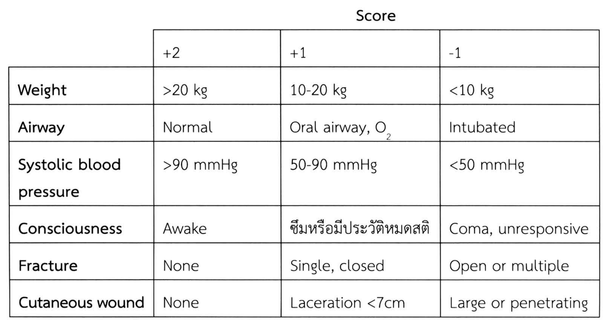
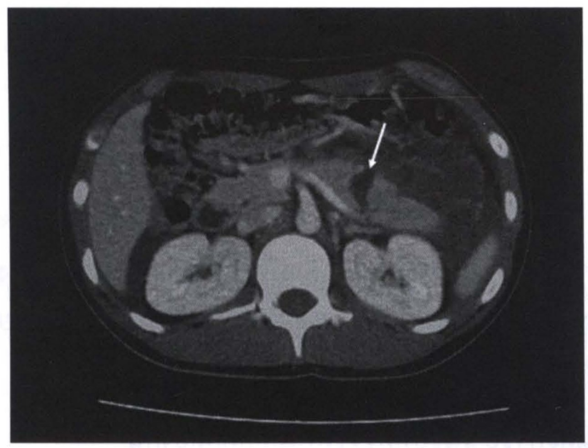

# การบาดเจ็บในเด็ก (Pediatric trauma)

## Contents of this file
- หลักการดูแลเบื้องต้น (p.1047)
- การบาดเจ็บบริเวณศีรษะ (Head injury) (p.1049)
- การบาดเจ็บบริเวณทรวงอก (Chest trauma) (p.1049)
- การบาดเจ็บช่องท้อง (Abdominal trauma) (p.1050)
- การบาดเจ็บต่อม้าม (p.1050)
- การบาดเจ็บต่อตับ (p.1052)
- การบาดเจ็บต่อตับอ่อน (p.1053)
- การบาดเจ็บต่อลำไส้ส่วนต้น (p.1054)
- การถูกทำร้ายร่างกาย (Child abuse) (p.1054)
- สรุป (p.1056)
- เอกสารอ้างอิง (p.1056)

<!-- p.1045 (printed none) -->
**การบาดเจ็บในเด็ก**

**Pediatric trauma**

ประภาพรรณ รัชตะปีติ

<!-- p.1046 (printed 1032) -->
**การบาดเจ็บในเด็ก**

**Pediatric trauma**

ประภาพรรณ รัชตะปีติ

การบาดเจ็บเป็นสาเหตุการเสียชีวิตอันดับหนึ่งในเด็ก ส่วนมากเกิดจากการบาดเจ็บแบบถูกกระแทก (blunt trauma) การที่ไม่สามารถดูแลทางเดินหายใจ และการหายใจรวมถึงการหาสาเหตุและรักษาภาวะเลือดออกในช่องท้องหรือการบาดเจ็บในศีรษะ เป็นปัจจัยสำคัญที่ส่งผลต่อการรอดชีวิตและผลการรักษาระยะยาว

Blunt injury ในเด็ก มักทำให้เกิดการบาดเจ็บหลายระบบจากอุบัติเหตุครั้งเดียว การประเมิน ณ ที่เกิดเหตุโดยอาศัย pediatric trauma score (ตารางที่ 1) ช่วยประเมินความรุนแรงของการบาดเจ็บและความเร่งด่วนในการส่งต่อ1 พบว่าหากประเมินได้น้อยกว่าหรือเท่ากับ 8 มีโอกาสเกิดการเสียชีวิตได้มากจึงควรส่งต่อไปยังโรงพยาบาลที่มีศักยภาพดูแลผู้ป่วยหนักได้

**ตารางที่ 1** Pediatric trauma score

**Score**

|  | +2 | +1 | -1 |
| --- | --- | --- | --- |
| **Weight** | >20 kg | 10-20 kg | <10 kg |
| **Airway** | Normal | Oral airway, O2 | Intubated |
| **Systolic blood pressure** | >90 mmHg | 50-90 mmHg | <50 mmHg |
| **Consciousness** | Awake | ซึมหรือมีประวัติหมดสติ | Coma, unresponsive |
| **Fracture** | None | Single, closed | Open or multiple |
| **Cutaneous wound** | None | Laceration <7cm | Large or penetrating |

> **Caption (verbatim):** ตารางที่ 1 Pediatric trauma score
> **Text in image (verbatim):** Score · +2 · +1 · -1 · Weight · >20 kg · 10-20 kg · <10 kg · Airway · Normal · Oral airway, O2 · Intubated · Systolic blood pressure · >90 mmHg · 50-90 mmHg · <50 mmHg · Consciousness · Awake · ซึมหรือมีประวัติหมดสติ · Coma, unresponsive · Fracture · None · Single, closed · Open or multiple · Cutaneous wound · None · Laceration <7cm · Large or penetrating
> **Description:** Table image saved because of its merged header: the word "Score" is a spanning heading over the three score columns (+2, +1, -1). Rows list six parameters (Weight, Airway, Systolic blood pressure, Consciousness, Fracture, Cutaneous wound) with the finding that earns +2, +1 or -1 points in each column; the content is identical to the Markdown table above.
> **Identifiers in image:** none

<!-- p.1047 (printed 1033) -->
## หลักการดูแลเบื้องต้น2-4

หลักการดูแลผู้ป่วยเด็กที่ได้รับการบาดเจ็บไม่ต่างจากการบาดเจ็บในผู้ใหญ่ โดยเรียงลำดับความสำคัญ ABCDE (Airway, Breathing, Circulation, Disability, Exposure) แม้หลักการจะไม่แตกต่างจากในผู้ใหญ่ แต่เด็กมีกายภาพและการตอบสนองต่อการบาดเจ็บที่ต่างไป จึงมีข้อพึงระวังในการดูแลขั้นตอนต่างๆ ดังจะกล่าวต่อไป

**Airway** การเปิดทางเดินหายใจมีความสำคัญเป็นอันดับแรกเพื่อป้องกันภาวะ hypoxia ลักษณะทางกายภาพที่มีผลต่อการดูแล airway ได้แก่

- ท้ายทอยนูน ทำให้เมื่อนอนราบมีโอกาสเกิดการอุดกั้นทางเดินหายใจได้ ควรใช้แผ่นรองบริเวณลำตัวให้ศีรษะอยู่ใน neutral position
- ลิ้นและ tonsils มีขนาดใหญ่ ทำให้ลิ้นตกไปปิดทางเดินหายใจได้ง่าย
- Larynx อยู่ค่อนมาด้านหน้า และ trachea สั้น ทำให้การใส่ท่อช่วยหายใจทำได้ยาก และมีโอกาสเข้าไปใน main bronchus ข้างขวาได้ง่าย
- ทางเดินหายใจมีขนาดเล็ก ในขณะที่มี secretion ปริมาณมาก อาจเกิดการอุดกั้นทางเดินหายใจได้แม้จะใส่ท่อช่วยหายใจแล้ว

ก่อนการช่วยเปิดทางเดินหายใจในเด็กต้องให้ออกซิเจนก่อนเสมอ การที่เด็กยังร้องหรือพูดได้บ่งว่า airway ไม่มีปัญหา การใส่ oral airway ห้ามทำในเด็กที่ยังรู้ตัว ข้อบ่งชี้ในการใส่ท่อช่วยหายใจ ได้แก่

(1) มีการบาดเจ็บสมองอย่างรุนแรง

(2) ไม่สามารถเปิดทางเดินหายใจได้ด้วยวิธี jaw trust หรือ oral airway

(3) มีอาการแสดงของภาวะหายใจล้มเหลว

(4) อยู่ในภาวะ hypovolemia รุนแรง สูญเสียการรับรู้ และอาจต้องได้รับการผ่าตัด

ขนาดของท่อช่วยหายใจขึ้นกับขนาดตัวเด็กโดยอาจประเมินคร่าวๆ จากขนาดนิ้วก้อยของเด็ก หรือใช้สูตรคำนวณ **4+อายุ (ปี)/4** ท่อช่วยหายใจมักเป็นแบบไม่มี cuff ใส่ให้ปลายผ่าน vocal cord  2-3 ซม. หลีกเลี่ยงการทำ surgical airway ในเด็ก เนื่องจากอาจเกิดการตีบแคบของทางเดินหายใจภายหลัง หากจำเป็นให้เลือกทำ needle cricothyroidotomy

<!-- p.1048 (printed 1034) -->
**Breathing** ประเมินการหายใจ ป้องกันการเกิด hypoxia ซึ่งอาจทำให้เกิดภาวะ respiratory acidosis ก่อนจะเกิด cardiac arrest หากไม่ได้รับการแก้ไขอย่างทันท่วงทีเนื่องจากกระดูกซี่โครงเด็กมีความยืดหยุ่นมากอาจตรวจไม่พบการหักของกระดูก แต่พบ lung contusion ได้บ่อย4 ต้องประเมินให้ดีว่ามีภาวะ pneumothorax หรือ hemothorax หรือไม่ โดยเฉพาะภาวะ tension pneumothorax ซึ่งต้องการการรักษารีบด่วน

**Circulation** ความดันโลหิตอาจจะไม่เปลี่ยนแปลงจนกว่าจะเสียเลือดประมาณร้อยละ 30 ของปริมาตรโลหิตในร่างกาย ควรประเมินจากชีพจรและ skin perfusion ประเมินหาตำแหน่งเลือดออก 5 ที่ ได้แก่ ช่องอก ช่องท้อง pelvis ภาวะกระดูกหัก และบาดแผลภายนอก

การเปิดเส้นเลือดเพื่อให้สารน้ำในเด็กมักทำได้ยากโดยเฉพาะเมื่อมีภาวะช็อก หากไม่สามารถเปิดเส้นเลือดบริเวณแขนหรือขาได้ อาจจำเป็นต้องให้สารน้ำผ่านทาง intraosseous โดยเจาะบริเวณกระดูก tibia ซึ่งทำได้เร็วกว่าการผ่าตัดเปิดเส้นเลือดบริเวณข้อเท้า ชนิดของสารน้ำที่ให้เลือกเป็น isotonic crystalloid อุ่น โดยให้เป็น bolus ตามน้ำหนักตัวครั้งแรก 20 มล. ต่อ กก. อาจให้ต่อ อีก 1 หรือ 2 รอบ ตามการตอบสนองของผู้ป่วย หากยังไม่ดีขึ้นพิจารณาให้ packed red cell ปริมาตร 10 มล. ต่อ กก.

**Disability** ประเมินระบบประสาทด้วย Glasgow Coma Score และการตอบสนองของม่านตา

**Exposure** พลิกตัวเพื่อตรวจหาการบาดเจ็บด้านหลังลำตัว และป้องกันภาวะ hypothermia ซึ่งเกิดได้ง่ายในเด็กเพราะมีพื้นที่ผิวลำตัวมาก

**การประเมินการตอบสนองต่อการรักษา** พิจารณาจาก

- อัตราการเต้นของหัวใจลดลง เช่น น้อยกว่า 140 ครั้งต่อนาที ในเด็กอายุ 3-5 ปี
- ระดับความรู้สึกตัวดีขึ้น
- สีผิวแดงขึ้น แขนขาอุ่นขึ้น
- ความดันโลหิตกลับมาเหมาะกับช่วงอายุ เช่น มากกว่า 80 มม. ปรอท สำหรับอายุ 3-5 ปี

<!-- p.1049 (printed 1035) -->
- Pulse pressure เพิ่มขึ้น (มากกว่า 20 มม. ปรอท)
- ปัสสาวะออก 1 ถึง 2 มล. ต่อ กก. ต่อ ชม.

## การบาดเจ็บบริเวณศีรษะ (Head injury)

การบาดเจ็บบริเวณศีรษะพบได้บ่อย และเป็นสาเหตุการตายอันดับหนึ่ง การบาดเจ็บบริเวณศีรษะมักมีเหตุจากอุบัติเหตุทางยานพาหนะ ถูกทำร้ายร่างกาย หรือตกจากที่สูง การบาดเจ็บของสมองในเด็กพบภาวะสมองบวมมากกว่าจะเป็น focal lesion หากภาวะ hypovolemia ได้รับการแก้ไขช้าอาจส่งผลให้การบาดเจ็บทางสมองแย่ลงจาก secondary brain injury ป้องกันได้โดยการดูแล oxygenation และ ventilation ให้เหมาะสม

พิจารณาปรึกษาประสาทศัลยแพทย์ หรือทำ CT scan ในเด็กที่มี Glasgow Coma Score น้อยกว่าหรือเท่ากับ 8 เด็กที่มีการบาดเจ็บหลายระบบ หรือต้องเข้ารับการผ่าตัด

## การบาดเจ็บบริเวณทรวงอก (Chest trauma)4, 5

การบาดเจ็บบริเวณทรวงอกเป็นสาเหตุการเสียชีวิตอันดับ 2 ในเด็กที่ได้รับการบาดเจ็บรองจากการบาดเจ็บบริเวณศีรษะ ส่วนมากเกิดจากลักษณะถูกกระแทก (blunt injury) โดยเฉพาะในการบาดเจ็บทางยานพาหนะ พบการบาดเจ็บบริเวณอื่นร่วมด้วยได้ถึง 2 ใน 3 ของเด็กที่มีการบาดเจ็บบริเวณทรวงอก การบาดเจ็บจากการถูกแทงหรือถูกยิงพบได้มากขึ้นในเด็กโตจากสาเหตุการทะเลาะวิวาท

ผนังทรวงอกของเด็กมีความยืดหยุ่นสูง แรงกระแทกจึงส่งผ่านไปยังปอดได้ ทำให้มีโอกาสเกิด pulmonary contusion ได้บ่อย นอกจากนี้ mediastinum เคลื่อนที่ได้มากทำให้เกิด tension pneumothorax ได้ง่ายเช่นกัน การบาดเจ็บอื่นๆ ไม่ต่างจากในผู้ใหญ่ แต่อาจพบได้น้อยกว่า เช่น great vessel injury, major airway tears, flail chest, diaphragmatic rupture หรือ cardiac contusion การบาดเจ็บบริเวณทรวงอกในเด็กมักรักษาได้โดยอาศัย supportive care และการใส่ท่อระบายในช่องทรวงอก มีไม่ถึงร้อยละ 10 ที่ต้องรักษาด้วยการผ่าตัด

<!-- p.1050 (printed 1036) -->
## การบาดเจ็บช่องท้อง (Abdominal trauma)6, 7

การบาดเจ็บช่องท้องในเด็กมักเกิดจากการถูกกระแทก จากอุบัติเหตุทางยานพาหนะ หรือตกจากที่สูง เนื่องจากลำตัวเด็กมีขนาดเล็ก ทำให้โอกาสรับแรงกระแทกได้มากกว่าผู้ใหญ่ นอกจากนี้ตับและม้ามยังมีขนาดใหญ่เทียบกับขนาดช่องท้อง ร่วมกับการมีผนังหน้าท้องที่ยังไม่แข็งแรงทำให้อวัยวะภายในมีโอกาสบาดเจ็บได้มากกว่าในผู้ใหญ่ ควรสงสัยการบาดเจ็บในช่องท้องหากตรวจพบรอยฟกช้ำบริเวณชายโครงหรือหน้าท้อง รอยเข็มขัดนิรภัย รอยกระแทกบริเวณลิ้นปี่จากอุบัติเหตุจักรยาน ในกรณีดังกล่าวควรส่งตรวจวินิจฉัยเพิ่มเติม รวมถึงกรณีที่เด็กไม่ให้ความร่วมมือในการตรวจร่างกาย

ในเด็กไม่นิยมทำ diagnostic peritoneal lavage เนื่องจากการบาดเจ็บของ solid organs ในช่องท้อง ได้แก่ ตับ ม้าม ตับอ่อน และไต มักรักษาได้โดยไม่ต้องผ่าตัด พิจารณาทำในกรณีที่ไม่สามารถส่งตรวจ CT scan ได้ และควรทำโดยศัลยแพทย์ผู้รับผิดชอบผู้ป่วย ส่วนการทำ FAST (Focused Assessment Sonography in Trauma) นั้นพบว่ายังไม่มีหลักฐานยืนยันความแม่นยำในการวินิจฉัยการบาดเจ็บของอวัยวะในช่องท้อง และไม่สามารถประเมินความรุนแรงการบาดเจ็บของ solid organ ซึ่งมีผลต่อการวางแผนการรักษาในเด็ก การตรวจวินิจฉัยที่แนะนำ ได้แก่ CT scan และควรฉีดสารทึบรังสีด้วยหากไม่มีข้อห้าม

การรักษาโดยการไม่ผ่าตัด (nonoperative management) ในเด็กที่มีการบาดเจ็บต่อ solid organ ในช่องท้องมีมานานกว่า 40 ปี โดยเริ่มจากการรักษาในรายที่มีการบาดเจ็บต่อม้ามเพียงอย่างเดียว ซึ่งหากตัดม้ามออกไปจะมีความเสี่ยงต่อ overwhelming post splenectomy sepsis (OPSS) ในปัจจุบันพบว่าการรักษาโดยไม่ผ่าตัดประสบความสำเร็จถึงร้อยละ 95 ของผู้ป่วยเด็กที่มีการบาดเจ็บ solid organ เพียงอย่างเดียว6 การผ่าตัดจะมีบทบาทในผู้ป่วยที่ไม่สามารถควบคุมภาวะ hemodynamic ได้

## การบาดเจ็บต่อม้าม

ม้ามเป็นอวัยวะที่ได้รับการบาดเจ็บบ่อยที่สุดในเด็กที่ได้รับการบาดเจ็บจากการถูกกระแทกบริเวณช่องท้อง ตับเป็นอวัยวะที่บาดเจ็บบ่อยรองลงมา ในกรณีที่สัญญาณชีพคงที่ปัจจุบันแนวการรักษาคือไม่ต้องผ่าตัด โดยควรทำ CT scan เพื่อประเมินอวัยวะบาดเจ็บและระดับความรุนแรง

<!-- p.1051 (printed 1037) -->
แนวทางการรักษาแบบไม่ผ่าตัดคือรับไว้ดูอาการอย่างใกล้ชิดในโรงพยาบาล ให้สารน้ำและส่วนประกอบของเลือดตามความเหมาะสม ประเมินผลการรักษาโดยดูสัญญาณชีพร่วมกับระดับความเข้มข้นของเม็ดเลือดแดงเป็นระยะ ทั้งนี้ต้องทำในสถาบันที่สามารถทำการผ่าตัดได้ทันทีหากเกิดการเปลี่ยนแปลง

การบาดเจ็บของม้ามแบ่งได้เป็น 5 ระดับ ดังแสดงในตารางที่ 2

**ตารางที่ 2** ความรุนแรงของการบาดเจ็บต่อม้าม

| Grade | Laceration | Hematoma |
| --- | --- | --- |
| I | <1 cm  parenchymal depth, capsular tear | subcapsular, <10% surface area |
| II | parenchyma 1-3 cm | subcapsular, 10-50% surface area intraparenchymal <5 cm |
| III | parenchymal tear >3 cm in depth | subcapsular, >50% surface area ruptured, subcapsular/ parenchymal ≥5 cm |
| IV | parenchymal involving >25% | Vascular injury, bleeding confined within spleen |
| V | Shattered spleen | Vascular injury, bleeding into peritoneum |

ข้อบ่งชี้ในการรักษาด้วยการผ่าตัดในเด็กที่มีการบาดเจ็บต่อม้าม คือ

- สัญญาณชีพไม่คงที่หลังจากได้รับสารน้ำและส่วนประกอบของเลือดอย่างเหมาะสมแล้ว
- มีอาการและอาการของการเสียเลือดอย่างต่อเนื่อง และต้องได้รับเลือดมากกว่าร้อยละ 50 ของปริมาตรเลือดในร่างกาย
- สงสัยว่ามีการบาดเจ็บของลำไส้ เช่น ลำไส้แตกทะลุร่วมด้วย

<!-- p.1052 (printed 1038) -->
การผ่าตัดมีหลายแบบตั้งแต่การเย็บซ่อมม้าม (splenorrhaphy) ตัดม้ามออกบางส่วน (partial splenectomy) หรือการตัดม้ามออกทั้งหมด (total splenectomy) ขึ้นกับสัญญาณชีพของผู้ป่วยขณะนั้น และวิจารณญาณของแพทย์ผู้ผ่าตัด หากตัดม้ามออกทั้งหมดต้องระวังการเกิดภาวะติดเชื้อแบบ overwhelming post splenectomy sepsis ซึ่งรุนแรงและมีอัตราการเสียชีวิตสูงภายหลังได้

## การบาดเจ็บต่อตับ

แนวทางการรักษาคล้ายกับการดูแลรักษาการบาดเจ็บต่อม้าม โดยพบว่าร้อยละ 90 ของเด็กที่ได้รับการบาดเจ็บต่อตับหายได้ด้วยการรักษาแบบไม่ผ่าตัด ความรุนแรงของการบาดเจ็บต่อตับแบ่งเป็น 5 ระดับ ดังแสดงในตารางที่ 3

**ตารางที่ 3** ความรุนแรงของการบาดเจ็บต่อตับ

| Grade | Laceration | Hematoma |
| --- | --- | --- |
| I | <1 cm  parenchymal depth | subcapsular, <10% surface area |
| II | capsular tear 1-3 cm parenchymal depth <10 cm length | subcapsular, 10-50% surface area intraparenchymal <10 cm diameter |
| III | capsular tear >3 cm parenchymal depth vascular injury with active bleeding contained within liver parenchyma | subcapsular, >50% surface area intraparenchymal >10 cm |
| IV | parenchymal disruption involving 25-75% hepatic lobe | Vascular injury, bleeding into peritoneum |
| V | parenchymal disruption >75% | IVC injury |

<!-- p.1053 (printed 1039) -->
บางรายอาจพบการบาดเจ็บของม้ามและตับร่วมกัน ซึ่งสามารถรักษาด้วยการไม่ผ่าตัดได้โดยอาศัยหลักการเดียวกันกับการบาดเจ็บเพียงอวัยวะเดียว ดังนี้

- เด็กที่สัญญาณชีพไม่คงที่หลังการให้สารน้ำและเลือดอย่างเหมาะสมแล้ว ให้พิจารณาผ่าตัดหยุดเลือดทันที
- เด็กที่มีสัญญาณชีพดีขึ้นต้องได้รับการติดตามอย่างต่อเนื่อง หากยังต้องได้รับเลือดเพิ่มเป็นระยะ อาจพิจารณารักษาด้วยการทำ angioembolization หากไม่สำเร็จ อาจต้องรักษาด้วยการผ่าตัดต่อไป

## การบาดเจ็บต่อตับอ่อน

การบาดเจ็บต่อตับอ่อนพบได้ไม่บ่อย มักพบในรายที่ถูกกระแทกบริเวณลิ้นปี่ เช่น การถูกกระแทกจากจักรยาน หากสงสัยการบาดเจ็บต่อตับอ่อนควรตรวจระดับ amylase และ lipase ในซีรั่ม เพื่อใช้ในการประเมินความรุนแรงของการบาดเจ็บร่วมกับผล CT scan การบาดเจ็บต่อตับอ่อนที่ไม่รุนแรง ไม่มีการบาดเจ็บต่อท่อตับอ่อน มักรักษาได้โดยไม่ต้องผ่าตัด แต่หากมีการบาดเจ็บต่อท่อตับอ่อนบริเวณ body และ tail (ดังรูป) มักแนะนำให้ทำผ่าตัด distal pancreatectomy

> **Caption (verbatim):** รูปแสดงการบาดเจ็บของตับอ่อนซึ่งจะเห็นการขาดออกจากกันของหางของตับอ่อนดังลูกศรชี้ (เอื้อเฟื้อรูปภาพโดย นพ. ไพศาล เวชชพิพัฒน์)
> **Text in image (verbatim):** none
> **Description:** Axial contrast-enhanced CT image of the upper abdomen at the level of the kidneys, displayed in the conventional orientation (patient's left on the image right). Visible structures: liver on the image left, bowel loops with gas anteriorly, aorta in front of the vertebral body, both kidneys with enhancing cortex on either side of the spine, ribs around the periphery and the back muscles posteriorly. A single white arrow, in the upper right part of the image (patient's left), points downward to a dark gap in the pancreatic tissue near the tail region; per the caption this shows the separation (transection) of the tail of the pancreas. A curved line below the body is the CT table.
> **Identifiers in image:** none

<!-- p.1054 (printed 1040) -->
ปัจจุบันการรักษาผ่านการส่องกล้อง (endoscopy) เข้ามามีบทบาทมากขึ้นในการดูแลการบาดเจ็บต่อท่อตับอ่อนบริเวณ head รวมถึงการใส่สาย หรือ stent ในรายที่เกิด pancreatic pseudocyst ในระยะต่อมา

## การบาดเจ็บต่อลำไส้ส่วนต้น

การบาดเจ็บต่อลำไส้จากแรงกระแทกพบได้น้อยแต่มีความสำคัญ โดยมักพบการบาดเจ็บบริเวณลำไส้ที่ยึดติดกับ retroperitoneum เช่น duodenum หรือ jejunum ส่วนต้น การบาดเจ็บของลำไส้บางครั้งวินิจฉัยได้ยากเนื่องจากยังไม่มีอาการแสดงในระยะแรก

การบาดเจ็บต่อกระเพาะอาหารพบใน penetrating injury มากกว่า ในการบาดเจ็บแบบถูกกระแทกอาจพบกระเพาะอาหารแตกในกรณีที่มี full stomach และได้รับแรงกระแทกอย่างรุนแรง

การมีเลือดออกในผนัง duodenum มักเกิดบริเวณ duodenum ส่วนที่ 3 จากแรงกระแทกบริเวณหน้าท้องที่กดลำไส้เข้ากับแนวกระดูกสันหลัง ทำให้เส้นเลือดในชั้น submucosa ฉีกขาด มีเลือดออกมาขังอยู่ในผนังลำไส้ ผู้ป่วยมักมีอาการประมาณ 1 สัปดาห์หลังเกิดการบาดเจ็บ เนื่องจากเกิดลำไส้เล็กส่วนต้นอุดตัน มีอาการจุก ปวดบริเวณลิ้นปี่ร่วมกับอาเจียนเป็นน้ำดี รักษาได้โดย ให้งดน้ำ งดอาหาร ใส่ nasogastric tube เพื่อระบายน้ำและลมจากกระเพาะ และให้สารอาหารทางหลอดเลือด ผู้ป่วยมักมีอาการดีขึ้นในเวลาไม่เกิน 2 สัปดาห์ โดยไม่ต้องผ่าตัด

## การถูกทำร้ายร่างกาย (Child abuse)

ปัจจุบันข่าวการถูกทำร้ายร่างกายต่อเด็กมีให้เห็นบ่อยขึ้นตามสื่อต่างๆ ในฐานะแพทย์ผู้ดูแลผู้ป่วยจึงควรซักประวัติและประเมินภาวการณ์บาดเจ็บของเด็กด้วยความถี่ถ้วน และควรสงสัยว่าเด็กถูกทำร้ายร่างกายเมื่อพบประวัติดังต่อไปนี้

- ประวัติและการบาดเจ็บที่ตรวจพบไม่สอดคล้องกัน
- เด็กถูกพามาพบแพทย์หลังบาดเจ็บช้า
- มีประวัติได้รับการบาดเจ็บซ้ำๆ

<!-- p.1055 (printed 1041) -->
- ประวัติที่ได้จากผู้ดูแลหลายคนไม่ตรงกัน
- ลักษณะการบาดเจ็บไม่สัมพันธ์กับกิจกรรมในช่วงอายุ เช่น พบขาหักในทารกอายุ 2 เดือน
- ผู้ปกครองไม่สนใจคำแนะนำของแพทย์
- มีประวัติเปลี่ยนสถานที่รักษาเด็กไปหลายที่

การตรวจร่างกายอาจพบลักษณะ

- มีรอยฟกช้ำหลายที่ แต่อยู่ในคนละระยะของการหาย
- การบาดเจ็บบริเวณ perineum หรือ อวัยวะเพศ
- การบาดเจ็บบริเวณรอบปาก (perioral area)
- กระดูกแขน ขาหักในเด็กอายุต่ำกว่า 3 ปี
- การบาดเจ็บของอวัยวะภายในช่องท้อง โดยไม่มีประวัติอุบัติเหตุรุนแรง
- เลือดออกใต้เยื่อหุ้มสมองหลายจุด แต่ไม่พบกะโหลกร้าว
- Retinal hemorrhage
- บาดแผลไฟไหม้ น้ำร้อนลวกที่มีขอบเขตชัดเจน
- กะโหลกศีรษะร้าว หรือซี่โครงหักในเด็กอายุน้อยกว่า 2 ปี
- การบาดเจ็บแปลกๆ เช่น รอยโดนกัด รอยบุหรี่จี้ เชือกรัด

หากสงสัยว่าเด็กถูกทำร้ายร่างกาย ควรพยายามแยกเด็กจากผู้ดูแล โดยพิจารณารับไว้ในโรงพยาบาล ปรึกษาหน่วยงานที่เกี่ยวข้องมาประเมินเพื่อให้การรักษา และป้องกันไม่ให้เกิดเหตุซ้ำในอนาคต

<!-- p.1056 (printed 1042) -->
## สรุป

การดูแลเบื้องต้นในผู้ป่วยเด็กที่ได้รับการบาดเจ็บไม่ต่างจากการดูแลผู้ใหญ่ คืออาศัยหลักการ ABCDE แต่เด็กมีลักษณะเฉพาะทางกายวิภาค และ physiology ที่ต้องคำนึงถึงในทุกขั้นตอนของการรักษา การประเมินซ้ำมีความจำเป็นอย่างยิ่งในการดูแลผู้ป่วยที่ได้รับการบาดเจ็บ ควรพิจารณาปรึกษาศัลยแพทย์มาร่วมดูแลผู้ป่วยตั้งแต่ต้น การบาดเจ็บของอวัยวะภายในช่องท้อง ส่วนมากรักษาได้โดยไม่ต้องผ่าตัด โดยเฉพาะในกรณีที่ไม่มีการแตกทะลุของลำไส้ร่วมด้วย แต่ต้องทำการรักษาในโรงพยาบาลที่มีความพร้อม

## เอกสารอ้างอิง

1. Tepas JJ, Ramenofsky ML, Mollitt DL, Gans BM, DiScala C. The Pediatric Trauma Score as a predictor of injury severity: an objective assessment. J Trauma. 1988;28(4):425-9.
2. Bruns NE, DeRoss AL. Trauma Resuscitation. In: Mattei P, Nichol P, Rollins II M, Muratore C, editors. Fundamentals of Pediatric Surgery. 2 ed: Springer, Cham; 2017. p. 111-7.
3. Pediatric trauma.  ATLS - Advanced trauma life support. 10 ed. Chicago, IL: ACS American College of Surgeon; 2018. p. 187-212.
4. Mikrogianakis A., Grant V. The Kids Are Alright: Pediatric Trauma Pearls. Emerg Med Clin North Am. 2018;36(1):237-57.
5. Wyrick DL, Maxson RT. Thoracic trauma. In: Holcomb III GW, Murphy JP, St.Peter SD, editors. Holcomb and Ashcraft’s pediatric surgery. 7 ed. London: Elsevier; 2019. p. 224-35.
6. Streck Jr CJ. Abdominal trauma. In: Mattei P, Nichol P, Rollins II M, Muratore C, editors. Fundamentals of Pediatric Surgery. 2 ed: Springer, Cham; 2017. p. 169-81.
7. Notrica DM. Abdominal and renal trauma. In: Holcomb III GW, Murphy JP, St.Peter SD, editors. Holcomb and Ashcraft’s pediatric surgery. 7 ed. London: Elsevier; 2019. p. 236-53.
